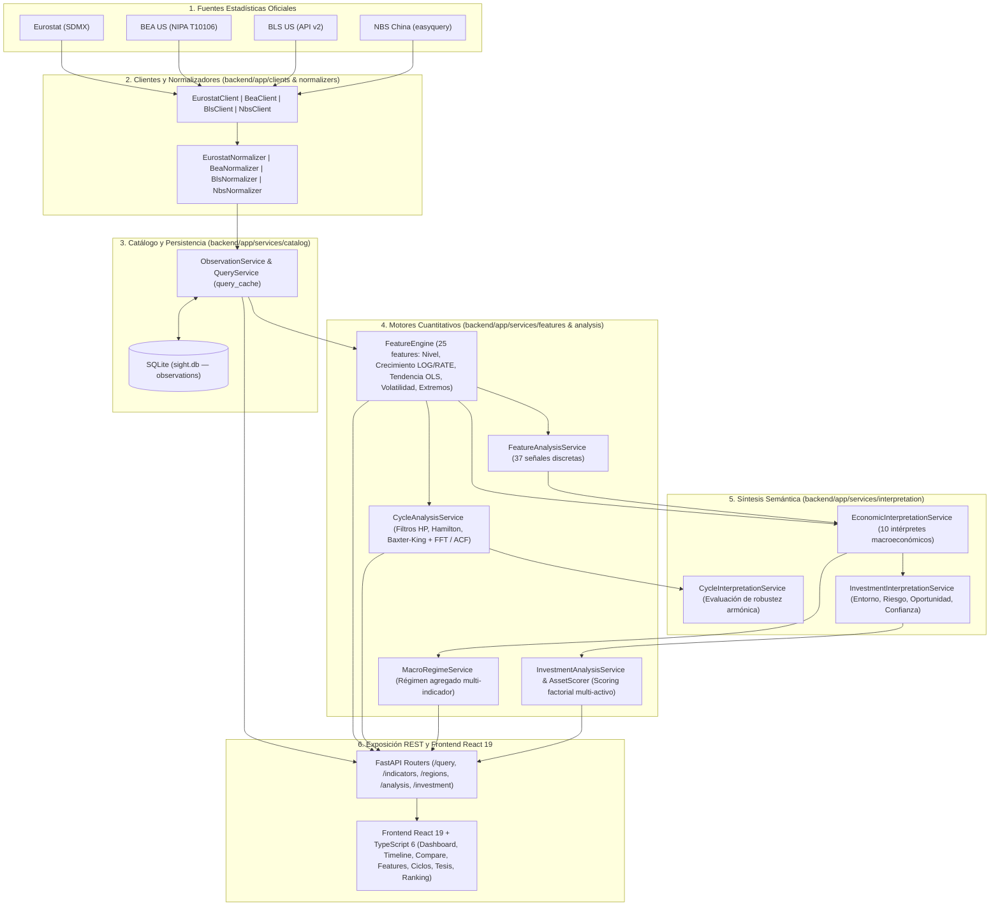

# Sight — Plataforma de Inteligencia Macroeconómica y Asignación de Activos

**Sight** es una plataforma integral de análisis cuantitativo macroeconómico, detección espectral de ciclos, clasificación de regímenes económicos agregados y formulación sistemática de tesis de inversión multi-activo. Combina un motor econométrico vectorizado en **Python / FastAPI** con una interfaz analítica reactiva en **React 19 / TypeScript / Vite**.

---

## 1. Arquitectura Global End-to-End

El sistema procesa datos oficiales desde su publicación en agencias estadísticas internacionales hasta su traducción en decisiones de inversión auditables a través de seis capas desacopladas:



---

## 2. Capacidades Principales

### 📊 Cobertura Macroeconómica y Geográfica
* **14 Indicadores Estandarizados**: PIB Real (`GDP`), Inflación (`INFLATION`), IPC (`CPI`), Desempleo (`UNEMPLOYMENT`), Tipos de Interés (`INTEREST_RATE`), Índice de Precios de Vivienda (`HOUSE_PRICE_INDEX`), Producción Industrial (`INDUSTRIAL_PRODUCTION`), Ventas Minoristas (`RETAIL_SALES`), Exportaciones (`EXPORTS` / `EXPORTS_BY_COUNTRY`), Importaciones (`IMPORTS` / `IMPORTS_BY_COUNTRY`) y Balanza Comercial (`TRADE` / `TRADE_BALANCE_BY_COUNTRY`).
* **16+ Regiones y Bloques Económicos**: Unión Europea (`EU27_2020`), Alemania (`DE`), Francia (`FR`), Italia (`IT`), España (`ES`), Países Bajos (`NL`), Polonia (`PL`), Bélgica (`BE`), Suecia (`SE`), Austria (`AT`), Irlanda (`IE`), Dinamarca (`DK`), Finlandia (`FI`), Chequia (`CZ`), Portugal (`PT`), Estados Unidos (`US`) y soporte de ingesta para China (`CN`).

### ⚡ Ingeniería Estadística Vectorizada (`features`)
* Cálculo en memoria contigua (NumPy/Pandas) de **23 métricas continuas** organizadas en 5 familias ortogonales (Nivel, Crecimiento, Tendencia OLS multiescala, Volatilidad y Extremos/Drawdowns).
* Tratamiento econométrico diferenciado entre series exponenciales (**`GrowthMethod.LOG`**) y series de tasas o saldos que admiten valores negativos (**`GrowthMethod.RATE`**).
* Generación automática de **37 señales analíticas discretas** mediante `FeatureAnalysisService`.

### 🔄 Detección Espectral de Ciclos Armónicos (`analysis/cycle`)
* Descomposición de tendencia/ciclo mediante tres filtros independientes: **Hodrick-Prescott (HP)**, **Regresión de Hamilton** y **Paso Banda de Baxter-King (BK)**.
* Estimación espectral combinada por **Transformada Rápida de Fourier (FFT)** y **Función de Autocorrelación (ACF)** con algoritmo de *clustering* y consenso para aislar ciclos robustos.

### 🧭 Clasificación de Regímenes y Asignación de Activos (`macro_regime` & `investment`)
* Clasificación en 7 regímenes macroeconómicos canónicos (`expansion`, `late_expansion`, `slowdown`, `contraction`, `recovery`, `stagnation`, `neutral`) con detección temprana de transiciones estructurales.
* Puntuación factorial de activos financieros (`AssetScorer` y `MacroFactorScorer`), estimación de convicción penalizada por incertidumbre y construcción de tesis cualitativas por horizonte temporal (corto, medio y largo plazo).

---

## 3. Estructura del Repositorio

```
sight/
├── README.md                          # Documentación general del proyecto
├── README_ERRORES.md                  # Índice maestro de auditoría de calidad (62 correcciones)
├── backend/
│   ├── app/
│   │   ├── main.py                    # Punto de entrada FastAPI + Lifespan SQLite + CORS
│   │   ├── api/routers/               # 11 routers RESTful (/query, /analysis, /investment, etc.)
│   │   ├── clients/                   # Clientes HTTP (Eurostat, BEA, BLS, NBS)
│   │   ├── normalizers/               # Normalizadores a modelos Observation canónicos
│   │   ├── mappers/                   # Mapeadores a esquemas de respuesta (RegionResponse, IndicatorResponse)
│   │   ├── models/                    # Modelos Pydantic y enumeraciones (Frequency, GrowthMethod, Unit)
│   │   ├── repositories/              # Capa de acceso transaccional a SQLite (ObservationRepository)
│   │   └── services/
│   │       ├── catalog/               # Servicios de catálogo, ingesta y consultas cacheadas
│   │       ├── features/              # Motor estadístico continuo y generador de señales
│   │       ├── analysis/              # Orquestador cuantitativo (cycle, macro_regime, investment)
│   │       └── interpretation/        # Motores semánticos (macro e investment)
│   ├── scripts/                       # Scripts de validación y backtesting histórico
│   └── tests/                         # Suite de 1.263 tests unitarios e integrados
└── frontend/
    ├── src/
    │   ├── api/                       # Cliente Axios e interceptores
    │   ├── hooks/                     # Hook determinista useAsyncData con AbortController
    │   ├── services/                  # Servicios HTTP de consulta global y régimen macro
    │   ├── layout/                    # MainLayout, Navbar, Sidebar y PageHeader
    │   ├── components/                # Paneles de análisis (MacroRegime, FutureAnalysis, CycleAnalysis, InvestmentThesis, AssetRanking)
    │   └── pages/                     # Dashboard, IndicatorsPage e IndicatorDetailPage (TimelineView & CompareView)
    └── package.json
```

---

## 4. Mapa Completo de Documentación Técnica y Auditorías

Cada capa y submódulo del repositorio cuenta con su propio manual de arquitectura (`README.md`) y su informe detallado de auditoría y corrección de errores (`README_ERRORES.md`):

### 🏛️ Índice Global
* [Informe Maestro Global de Errores (`README_ERRORES.md`)](README_ERRORES.md)

### ⚙️ Backend — Servicios de Dominio (`backend/app/services/`)
* **Visión General de Servicios**:
  - [Arquitectura General de Servicios (`backend/app/services/README.md`)](backend/app/services/README.md)
  - [Informe Maestro de Errores de Servicios (`backend/app/services/README_ERRORES.md`)](backend/app/services/README_ERRORES.md)
* **1. Catálogo, Ingesta y Consultas (`catalog`)**:
  - [Documentación Técnica (`backend/app/services/catalog/README.md`)](backend/app/services/catalog/README.md)
  - [Informe de Errores (`backend/app/services/catalog/README_ERRORES.md`)](backend/app/services/catalog/README_ERRORES.md)
* **2. Ingeniería de Características y Señales (`features`)**:
  - [Documentación Técnica (`backend/app/services/features/README.md`)](backend/app/services/features/README.md)
  - [Informe de Errores (`backend/app/services/features/README_ERRORES.md`)](backend/app/services/features/README_ERRORES.md)
* **3. Modelado Econométrico y Cuantitativo (`analysis`)**:
  - [Arquitectura General de Análisis (`backend/app/services/analysis/README.md`)](backend/app/services/analysis/README.md)
  - [Submódulo de Ciclos Espectrales (`backend/app/services/analysis/cycle/README.md`)](backend/app/services/analysis/cycle/README.md)
  - [Submódulo de Régimen Macroeconómico (`backend/app/services/analysis/macro_regime/README.md`)](backend/app/services/analysis/macro_regime/README.md)
  - [Submódulo de Inversión y Activos (`backend/app/services/analysis/investment/README.md`)](backend/app/services/analysis/investment/README.md)
  - [Informe de Errores de Análisis (`backend/app/services/analysis/README_ERRORES.md`)](backend/app/services/analysis/README_ERRORES.md)
* **4. Interpretación Semántica e Inteligencia de Inversión (`interpretation`)**:
  - [Arquitectura General de Interpretación (`backend/app/services/interpretation/README.md`)](backend/app/services/interpretation/README.md)
  - [Submódulo de Interpretación Macroeconómica (`backend/app/services/interpretation/macro/README.md`)](backend/app/services/interpretation/macro/README.md)
  - [Submódulo de Interpretación de Inversión (`backend/app/services/interpretation/investment/README.md`)](backend/app/services/interpretation/investment/README.md)
  - [Informe General de Errores de Interpretación (`backend/app/services/interpretation/README_ERRORES.md`)](backend/app/services/interpretation/README_ERRORES.md)
  - [Informe de Errores Macro (`backend/app/services/interpretation/macro/README_ERRORES.md`)](backend/app/services/interpretation/macro/README_ERRORES.md)
  - [Informe de Errores de Inversión (`backend/app/services/interpretation/investment/README_ERRORES.md`)](backend/app/services/interpretation/investment/README_ERRORES.md)

### 🌐 Backend — Capa API, Clientes y Normalizadores
* **Routers FastAPI (`api/routers`)**:
  - [Arquitectura de Routers (`backend/app/api/routers/README.md`)](backend/app/api/routers/README.md)
  - [Informe de Errores de Routers (`backend/app/api/routers/README_ERRORES.md`)](backend/app/api/routers/README_ERRORES.md)
* **Clientes Externos (`clients`)**:
  - [Arquitectura de Clientes (`backend/app/clients/README.md`)](backend/app/clients/README.md)
  - [Informe de Errores de Clientes (`backend/app/clients/README_ERRORES.md`)](backend/app/clients/README_ERRORES.md)
* **Normalizadores (`normalizers`)**:
  - [Arquitectura de Normalizadores (`backend/app/normalizers/README.md`)](backend/app/normalizers/README.md)
  - [Informe de Errores de Normalizadores (`backend/app/normalizers/README_ERRORES.md`)](backend/app/normalizers/README_ERRORES.md)

### 🖥️ Frontend — Aplicación Web React 19 (`frontend/`)
* [Arquitectura Técnica del Frontend (`frontend/README.md`)](frontend/README.md)
* [Informe de Errores del Frontend (`frontend/README_ERRORES.md`)](frontend/README_ERRORES.md)

---

## 5. Guía de Instalación y Ejecución Rápida

### 5.1 Requisitos Previos
* **Python**: `>= 3.12`
* **Node.js**: `>= 20.x` y `npm`

### 5.2 Configuración del Backend
```bash
cd backend
python -m venv .venv
source .venv/bin/activate
pip install -r requirements.txt

# Configurar variables de entorno (BEA_API_KEY, BLS_API_KEY)
cp .env.example .env

# Ejecutar la suite completa de tests (1.263 tests)
pytest -q

# Iniciar el servidor FastAPI en http://localhost:8000
uvicorn app.main:app --reload
```

### 5.3 Configuración del Frontend
```bash
cd frontend
npm install

# Verificar ESLint y compilación TypeScript
npm run lint
npm run build

# Iniciar el servidor de desarrollo en http://localhost:5173
npm run dev
```
