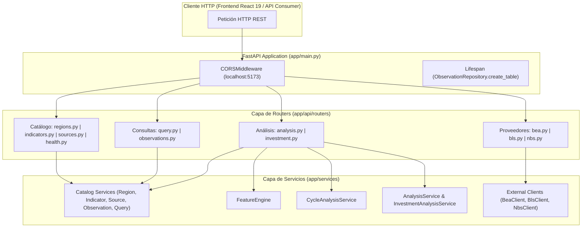

# Arquitectura de Routers y Capa HTTP: `app/api/routers`

El directorio `app/api/routers` constituye la capa de exposición RESTful de **Sight** construida sobre **FastAPI**. Su responsabilidad es recibir las peticiones HTTP del frontend o clientes externos, normalizar y validar los parámetros de entrada (`region_code`, `indicator_code`, fechas de corte), invocar de forma aislada a los servicios del dominio (`catalog`, `features`, `analysis`, `interpretation`), serializar las respuestas conforme a los contratos Pydantic y traducir cualquier excepción de dominio en códigos de estado HTTP semánticos (`200`, `400`, `404`, `500`, `502`).

---

## 1. Principios de Diseño de la Capa API

1. **Controladores Delgados (*Thin Routers*)**:
   - Los routers no contienen lógica econométrica ni consultas SQL directas; delegan toda la computación a `app/services/`.
2. **Traducción Semántica de Errores HTTP**:
   - `404 Not Found`: Indicador o región inexistente, o ausencia de observaciones para el par solicitado.
   - `400 Bad Request`: Parámetros de consulta vacíos, rangos inválidos o series que incumplen precondiciones matemáticas de entrada (`ValueError` de análisis).
   - `502 Bad Gateway`: Fallos de comunicación con proveedores estadísticos externos en los endpoints directos de ingesta (`/bea`, `/bls`, `/nbs`).
   - `500 Internal Server Error`: Errores internos inesperados.
3. **Resolución Transparente de Indicadores Sintéticos (`TRADE`)**:
   - El indicador `TRADE` (*Balanza Comercial = Exportaciones − Importaciones*) se calcula dinámicamente a través de `QueryService._compute_trade_observations()` tanto en los endpoints de consulta (`/query`, `/observations`) como en los de análisis profundo (`/analysis/features`, `/analysis/cycle`, `/analysis/investment`).
4. **Tolerancia a Cobertura Parcial en Análisis Multi-Indicador**:
   - Tanto `GET /analysis/regime/{region_code}` como `GET /investment/{region_code}` iteran sobre la cesta de 6 indicadores macroeconómicos troncales capturando individualmente `ValueError`, de modo que si un país carece de uno de los indicadores (por ejemplo, `HOUSE_PRICE_INDEX` en EE. UU.), el régimen y el ranking de activos se calculan con los indicadores disponibles sin interrumpir el servicio.

---

## 2. Mapa de Estructura de Routers

```
backend/app/api/
├── __init__.py                # Re-exportación formal de todos los routers
└── routers/
    ├── __init__.py            # Registro de routers exportados (__all__)
    ├── health.py              # Estado operativo del servidor (/health)
    ├── regions.py             # Catálogo de regiones y bloques económicos (/regions)
    ├── indicators.py          # Catálogo y metadatos de indicadores (/indicators)
    ├── sources.py             # Catálogo de fuentes estadísticas oficiales (/sources)
    ├── observations.py        # Acceso directo a series de observaciones (/observations)
    ├── query.py               # Consultas agregadas, series por región/indicador y comparativas (/query)
    ├── analysis.py            # Motores de Features, Ciclos, Régimen Macro y Tesis (/analysis)
    ├── investment.py          # Ranking cuantitativo multi-activo por región (/investment)
    ├── bea.py                 # Proxy directo a Bureau of Economic Analysis (/bea)
    ├── bls.py                 # Proxy directo a Bureau of Labor Statistics (/bls)
    └── nbs.py                 # Proxy directo a National Bureau of Statistics of China (/nbs)
```

---

## 3. Diagrama de Enrutamiento y Flujo de Peticiones



---

## 4. Catálogo Exhaustivo de Endpoints y Contratos

### 4.1 Salud y Metadatos de Catálogo
| Método y Ruta | Router | Servicio Invocado | Modelo de Respuesta | Descripción |
|:---|:---|:---|:---|:---|
| `GET /health` | [`health.py`](file:///home/dano/sight/backend/app/api/routers/health.py) | — | `{"status": "ok"}` | Verificación de disponibilidad del servicio. |
| `GET /regions` | [`regions.py`](file:///home/dano/sight/backend/app/api/routers/regions.py) | `RegionService.get_regions()` | `list[Region]` | Lista todas las regiones y países soportados (soporta con y sin `/` final sin redirección 307). |
| `GET /regions/{code}` | [`regions.py`](file:///home/dano/sight/backend/app/api/routers/regions.py) | `RegionService.get_region()` | `Region` | Detalle de una región por su código ISO/Eurostat. |
| `GET /indicators` | [`indicators.py`](file:///home/dano/sight/backend/app/api/routers/indicators.py) | `IndicatorService.get_indicators()` | `list[Indicator]` | Lista los 14 indicadores del catálogo con frecuencia, unidad y `GrowthMethod`. |
| `GET /indicators/{code}` | [`indicators.py`](file:///home/dano/sight/backend/app/api/routers/indicators.py) | `IndicatorService.get_indicator()` | `Indicator` | Metadatos de un indicador específico. |
| `GET /sources` | [`sources.py`](file:///home/dano/sight/backend/app/api/routers/sources.py) | `SourceService.get_sources()` | `list[Source]` | Lista las fuentes estadísticas oficiales (`EUROSTAT`, `BEA`, `BLS`, `ECB`, `OECD`, `FRED`, `NBS`). |
| `GET /sources/{code}` | [`sources.py`](file:///home/dano/sight/backend/app/api/routers/sources.py) | `SourceService.get_by_code()` | `Source` | Detalle de una fuente estadística por código. |

### 4.2 Consultas Históricas y Comparativas Transversales
| Método y Ruta | Router | Servicio Invocado | Modelo de Respuesta | Descripción |
|:---|:---|:---|:---|:---|
| `GET /observations/{indicator_code}?region={r}` | [`observations.py`](file:///home/dano/sight/backend/app/api/routers/observations.py) | `ObservationService.get_observations()` / `QueryService._compute_trade_observations()` | `list[Observation]` | Devuelve observaciones completas (incluyendo metadatos anidados de región, indicador y fuente). |
| `GET /query/region/{region_code}` | [`query.py`](file:///home/dano/sight/backend/app/api/routers/query.py) | `QueryService.get_by_region()` | `RegionResponse` | Todas las series disponibles para una región agrupadas por código de indicador. |
| `GET /query/indicator/{indicator_code}` | [`query.py`](file:///home/dano/sight/backend/app/api/routers/query.py) | `QueryService.get_by_indicator()` | `IndicatorResponse` | Todas las series de un indicador agrupadas por región. |
| `GET /query/region/{region_code}/indicator/{indicator_code}` | [`query.py`](file:///home/dano/sight/backend/app/api/routers/query.py) | `QueryService.get_by_region_and_indicator()` | `RegionResponse` | Serie histórica individual con caché en memoria (`query_cache`). |
| `GET /query/compare?indicator={i}&regions={r1,r2,...}` | [`query.py`](file:///home/dano/sight/backend/app/api/routers/query.py) | `QueryService.compare_regions()` | `list[RegionResponse]` | Comparativa multi-país para un indicador dado. |

### 4.3 Motores Analíticos y de Inversión
| Método y Ruta | Router | Servicio Invocado | Modelo de Respuesta | Descripción |
|:---|:---|:---|:---|:---|
| `GET /analysis/features/{indicator_code}/{region_code}` | [`analysis.py`](file:///home/dano/sight/backend/app/api/routers/analysis.py) | `FeatureEngine.compute()` | `FeatureAnalysisResult` | Calcula las 23 métricas continuas de nivel, crecimiento (`LOG`/`RATE`), tendencia, volatilidad y extremos. |
| `GET /analysis/cycle/{indicator_code}/{region_code}` | [`analysis.py`](file:///home/dano/sight/backend/app/api/routers/analysis.py) | `CycleAnalysisService.analyze()` | `CycleAnalysisResult` | Descomposición espectral (HP, Hamilton, Baxter-King + FFT/ACF) y ciclos robustos de consenso. |
| `GET /analysis/investment/{indicator_code}/{region_code}` | [`analysis.py`](file:///home/dano/sight/backend/app/api/routers/analysis.py) | `AnalysisService.analyze()` → `InvestmentAnalysisService.analyze()` | `dict` (`InvestmentAnalysisResult`) | Tesis cualitativa de inversión, entorno, riesgo, oportunidad, horizontes y alertas del indicador. |
| `GET /analysis/regime/{region_code}` | [`analysis.py`](file:///home/dano/sight/backend/app/api/routers/analysis.py) | `AnalysisService.analyze_multiple()` | `dict` | Clasificación del régimen macroeconómico agregado de la región a partir de sus indicadores principales. |
| `GET /investment/{region_code}` | [`investment.py`](file:///home/dano/sight/backend/app/api/routers/investment.py) | `AnalysisService.analyze_multiple()` | `dict` (`InvestmentAssetRankingResult`) | Puntuación factorial y ranking cuantitativo multi-activo para la región. |

### 4.4 Clientes Directos de Proveedores Estadísticos
| Método y Ruta | Router | Cliente Invocado | Descripción |
|:---|:---|:---|:---|
| `GET /bea/gdp` | [`bea.py`](file:///home/dano/sight/backend/app/api/routers/bea.py) | `BeaClient.get_gdp()` | Consulta en crudo del PIB de EE. UU. desde BEA. |
| `GET /bls/inflation`, `GET /bls/unemployment` | [`bls.py`](file:///home/dano/sight/backend/app/api/routers/bls.py) | `BlsClient` | Consulta en crudo de inflación y desempleo de EE. UU. desde BLS. |
| `GET /nbs/cpi`, `GET /nbs/gdp`, `GET /nbs/unemployment`, `GET /nbs/inflation` | [`nbs.py`](file:///home/dano/sight/backend/app/api/routers/nbs.py) | `NbsClient` | Consulta en crudo de series macroeconómicas de China desde NBS. |
