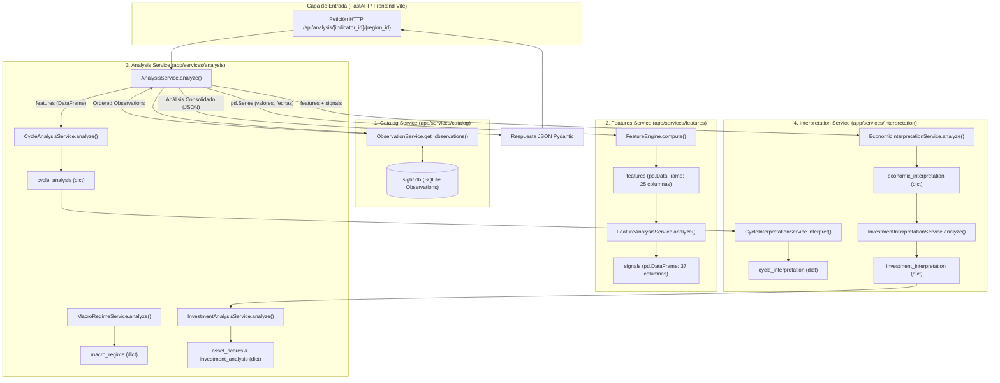

# Arquitectura General de Servicios: `app/services`

El directorio `app/services` constituye el núcleo computacional y analítico de **Sight**. Su misión es procesar series temporales macroeconómicas heterogéneas desde su ingesta oficial hasta convertirlas en inteligencia de mercado: identificación de ciclos periódicos, clasificación de regímenes económicos agregados, evaluación cualitativa de riesgos y oportunidades, y generación de tesis de asignación de activos.

---

## 1. Cadena de Valor y Filosofía del Sistema

La arquitectura de servicios de **Sight** está diseñada bajo tres principios rectores:

1. **Aislamiento Funcional Estricto**:
   - `catalog` sólo gestiona persistencia, consultas e ingesta; desconoce matemáticas avanzadas.
   - `features` calcula transformaciones estadísticas y señales discretas; no emite juicios de valor.
   - `analysis` implementa algoritmos econométricos pesados (desestacionalización, detrending espectral, scoring matricial).
   - `interpretation` dota de significado semántico humano a las métricas matemáticas, separando limpiamente la economía descriptiva neutral del marco de toma de decisiones de inversión.
2. **Eficiencia Vectorizada y Baja Latencia**:
   - Algoritmos vectorizados mediante NumPy y Pandas sobre memoria contigua, minimizando bucles en Python y garantizando respuestas sub-segundo en APIs y visualizaciones frontend.
3. **Resiliencia Defensiva de Datos**:
   - Gestión robusta de lagunas temporales, series cortas, tipos de interés negativos y valores nulos/`NaN` sin lanzar excepciones no controladas.

---

## 2. Mapa de Estructura de Servicios

```
app/services/
├── catalog/                   # 1. Capa de Datos, Ingesta y Persistencia
│   ├── category_service.py    # Categorías temáticas de indicadores
│   ├── indicator_service.py   # Metadatos y registro de indicadores
│   ├── observation_service.py # Ingesta y persistencia de observaciones en SQLite
│   ├── query_service.py       # Consultas agregadas con caché en memoria
│   ├── region_service.py      # Áreas geográficas y países
│   └── source_service.py      # Proveedores de datos oficiales (Eurostat, BEA, BLS, NBS)
│
├── features/                  # 2. Ingeniería de Características y Señales
│   ├── feature_engine.py      # Motor estadístico continuo (5 familias ortogonales)
│   ├── feature_analysis_service.py # Generador de señales analíticas discretas
│   ├── level_features.py      # Medias móviles, percentiles, z-scores
│   ├── growth_features.py     # Variaciones periódicas (LOG vs RATE)
│   ├── trend_features.py      # Pendientes OLS vectorizadas (corto, medio, largo plazo)
│   ├── volatility_features.py # Volatilidad rodante, z-score de estrés y choques
│   ├── extreme_features.py    # Máximos, mínimos históricos y drawdowns
│   └── utils/                 # Algoritmos numéricos, regresión OLS y validaciones
│
├── analysis/                  # 3. Modelado Econométrico y Scoring de Activos
│   ├── analysis_service.py    # Orquestador general del pipeline de análisis
│   ├── cycle/                 # Submódulo de ciclos espectrales (FFT, ACF, HP, Hamilton)
│   ├── macro_regime/          # Submódulo de regímenes agregados multi-indicador
│   └── investment/            # Submódulo de scoring y convicción multi-activo
│
└── interpretation/            # 4. Síntesis Semántica e Inteligencia de Inversión
    ├── constants.py           # Contratos canónicos REQUIRED_FEATURES y REQUIRED_SIGNALS
    ├── utils.py               # Serialización, safe_float y safe_bool
    ├── macro/                 # Semántica Macroeconómica Pura (10 componentes descriptivos)
    └── investment/            # Interpretación de Inversión (Entorno, Riesgo, Oportunidad, Confianza)
```

---

## 3. Diagrama Integral de Flujo de Información

El siguiente diagrama ilustra el flujo integral de datos a través de los cuatro servicios, desde la consulta original del usuario o API hasta la respuesta serializada final:



---

## 4. Matriz de Conexiones y Contratos entre Servicios

| Servicio Emisor | Objeto / Contrato Saliente | Servicio Receptor | Método / Función Receptora | Propósito |
|:---|:---|:---|:---|:---|
| [`catalog`](file:///home/dano/sight/backend/app/services/catalog/README.md) | `list[Observation]` | [`analysis`](file:///home/dano/sight/backend/app/services/analysis/README.md) | `AnalysisService.analyze()` | Provee observaciones históricas limpias ordenadas cronológicamente. |
| [`analysis`](file:///home/dano/sight/backend/app/services/analysis/README.md) | `pd.Series` (fechas y valores) | [`features`](file:///home/dano/sight/backend/app/services/features/README.md) | `FeatureEngine.compute()` | Extrae la serie univariante para cálculo estadístico continuo. |
| [`features`](file:///home/dano/sight/backend/app/services/features/README.md) | `features (pd.DataFrame)` | [`features`](file:///home/dano/sight/backend/app/services/features/README.md) | `FeatureAnalysisService.analyze()` | Transforma variables cuantitativas en señales direccionales discretas. |
| [`features`](file:///home/dano/sight/backend/app/services/features/README.md) | `features (pd.DataFrame)` | [`analysis/cycle`](file:///home/dano/sight/backend/app/services/analysis/cycle/README.md) | `CycleAnalysisService.analyze()` | Alimenta los filtros de detrending (HP, Hamilton, Baxter-King) y periodogramas FFT. |
| [`features`](file:///home/dano/sight/backend/app/services/features/README.md) | `features + signals (DataFrames)` | [`interpretation/macro`](file:///home/dano/sight/backend/app/services/interpretation/macro/README.md) | `EconomicInterpretationService.analyze()` | Evalúa crecimiento, tendencias, momentum, volatilidad y posición relativa. |
| [`analysis/cycle`](file:///home/dano/sight/backend/app/services/analysis/cycle/README.md) | `cycle_analysis (dict)` | [`interpretation/macro`](file:///home/dano/sight/backend/app/services/interpretation/macro/README.md) | `CycleInterpretationService.interpret()` | Traduce las frecuencias espectrales a lenguaje económico con niveles de convicción y cautelas. |
| [`interpretation/macro`](file:///home/dano/sight/backend/app/services/interpretation/macro/README.md) | `economic_interpretation (dict)` | [`interpretation/investment`](file:///home/dano/sight/backend/app/services/interpretation/investment/README.md) | `InvestmentInterpretationService.analyze()` | Convierte el diagnóstico macroeconómico neutral en señales de entorno, riesgo y oportunidad. |
| [`interpretation/investment`](file:///home/dano/sight/backend/app/services/interpretation/investment/README.md) | `investment_interpretation (dict)` | [`analysis/investment`](file:///home/dano/sight/backend/app/services/analysis/investment/README.md) | `InvestmentAnalysisService.analyze()` | Pondera activos financieros (renta fija, renta variable, materias primas, oro) y construye la tesis cualitativa. |
| [`analysis`](file:///home/dano/sight/backend/app/services/analysis/README.md) | `Full Analysis Payload (dict)` | `API Routers` (`api/routers/analysis.py`) | Endpoint FastAPI | Serializa y expone el resultado completo a la interfaz de usuario. |

---

## 5. Pipeline de Ejecución Paso a Paso

1. **Ingesta y Validación de Datos ([`catalog`](file:///home/dano/sight/backend/app/services/catalog/README.md))**:
   - `ObservationService` recupera las observaciones históricas para el indicador y región solicitados.
   - Las observaciones se filtran para eliminar nulos y duplicados, ordenándose estrictamente por fecha ascendente.
2. **Generación de Características Numéricas ([`features`](file:///home/dano/sight/backend/app/services/features/README.md))**:
   - `FeatureEngine` detecta la frecuencia de la serie (mensual, trimestral, anual) y su método de crecimiento (`LOG` vs `RATE`).
   - Se calculan vectorizadamente 23 métricas estadísticas organizadas en 5 familias: niveles, variaciones, tendencias multiescala, volatilidad y extremos históricos.
3. **Generación de Señales Cuantitativas ([`features`](file:///home/dano/sight/backend/app/services/features/README.md))**:
   - `FeatureAnalysisService` evalúa las métricas continuas contra umbrales económicos normalizados para derivar 37 señales discretas booleanas (e.g. `bullish_trend`, `positive_momentum`, `high_volatility`).
4. **Detección de Ciclos Armónicos ([`analysis/cycle`](file:///home/dano/sight/backend/app/services/analysis/cycle/README.md))**:
   - `CycleAnalysisService` descompone la serie mediante 3 métodos de filtrado ortogonales (Hodrick-Prescott, Hamilton OLS y Baxter-King).
   - Ejecuta FFT y autocorrelación (ACF) sobre cada serie residual y aplica un algoritmo de consenso/clustering para identificar periodicidades robustas.
   - `CycleInterpretationService` evalúa la calidad de la muestra según los ciclos observables completos y emite las advertencias metodológicas pertinentes.
5. **Interpretación Macroeconómica ([`interpretation/macro`](file:///home/dano/sight/backend/app/services/interpretation/macro/README.md))**:
   - `EconomicInterpretationService` coordina 5 intérpretes dimensionales: crecimiento (`GrowthInterpreter`), tendencia (`TrendInterpreter`), momentum (`MomentumInterpreter`), volatilidad (`VolatilityInterpreter`) y posición relativa (`PositionInterpreter`).
   - `TransitionDetector` detecta dinámicas de cambio estructural tempranas con puntuaciones de convicción.
   - `RegimeClassifier` sintetiza toda la evidencia en uno de los 7 regímenes macroeconómicos canónicos (`expansion`, `late_expansion`, `slowdown`, `contraction`, `recovery`, `stagnation`, `neutral`).
   - `AssessmentBuilder` redacta el resumen ejecutivo y calcula el índice de coherencia estructural.
6. **Interpretación y Formulación de Inversión ([`interpretation/investment`](file:///home/dano/sight/backend/app/services/interpretation/investment/README.md) y [`analysis/investment`](file:///home/dano/sight/backend/app/services/analysis/investment/README.md))**:
   - `InvestmentInterpretationService` clasifica el entorno de mercado, extrae el catálogo de riesgos activos, cataloga ventanas de oportunidad e identifica divergencias macroeconómicas mediante `ConfidenceEstimator`.
   - `InvestmentAnalysisService` califica los activos del universo de inversión mediante `AssetScorer` y `MacroFactorScorer`, clasifica horizontes temporales óptimos (`HorizonAnalyzer`), evalúa sesgos macro (`MacroBiasAnalyzer`) y redacta la tesis de inversión cualitativa (`OverallAssessmentBuilder`).

---

## 6. Documentaciones Detalladas por Módulo

Para profundizar en la implementación interna, fórmulas matemáticas, parámetros y auditorías de cada componente:

* 📊 **Catálogo e Ingesta de Datos**:
  - [Documentación Técnica: `app/services/catalog/README.md`](file:///home/dano/sight/backend/app/services/catalog/README.md)
  - [Registro de Errores: `app/services/catalog/README_ERRORES.md`](file:///home/dano/sight/backend/app/services/catalog/README_ERRORES.md)
* ⚡ **Ingeniería de Características y Señales**:
  - [Documentación Técnica: `app/services/features/README.md`](file:///home/dano/sight/backend/app/services/features/README.md)
  - [Registro de Errores: `app/services/features/README_ERRORES.md`](file:///home/dano/sight/backend/app/services/features/README_ERRORES.md)
* 📈 **Econometría y Análisis Cuantitativo**:
  - [Documentación Técnica General: `app/services/analysis/README.md`](file:///home/dano/sight/backend/app/services/analysis/README.md)
  - [Submódulo de Ciclos: `app/services/analysis/cycle/README.md`](file:///home/dano/sight/backend/app/services/analysis/cycle/README.md)
  - [Submódulo de Regímenes: `app/services/analysis/macro_regime/README.md`](file:///home/dano/sight/backend/app/services/analysis/macro_regime/README.md)
  - [Submódulo de Inversión: `app/services/analysis/investment/README.md`](file:///home/dano/sight/backend/app/services/analysis/investment/README.md)
  - [Registro de Errores: `app/services/analysis/README_ERRORES.md`](file:///home/dano/sight/backend/app/services/analysis/README_ERRORES.md)
* 🧠 **Interpretación Semántica y Tesis**:
  - [Documentación Técnica General: `app/services/interpretation/README.md`](file:///home/dano/sight/backend/app/services/interpretation/README.md)
  - [Submódulo Macroeconómico: `app/services/interpretation/macro/README.md`](file:///home/dano/sight/backend/app/services/interpretation/macro/README.md)
  - [Submódulo de Inversión: `app/services/interpretation/investment/README.md`](file:///home/dano/sight/backend/app/services/interpretation/investment/README.md)
  - [Registro de Errores General: `app/services/interpretation/README_ERRORES.md`](file:///home/dano/sight/backend/app/services/interpretation/README_ERRORES.md)
  - [Registro de Errores Macro: `app/services/interpretation/macro/README_ERRORES.md`](file:///home/dano/sight/backend/app/services/interpretation/macro/README_ERRORES.md)
  - [Registro de Errores Inversión: `app/services/interpretation/investment/README_ERRORES.md`](file:///home/dano/sight/backend/app/services/interpretation/investment/README_ERRORES.md)
