# Arquitectura Técnica Exhaustiva y Flujo de Métodos: `app/services/analysis`

El módulo `app/services/analysis` constituye el motor econométrico y de asignación de activos de **Sight**. Su función es transformar observaciones temporales de indicadores económicos en ciclos identificados, regímenes macroeconómicos agregados y un ranking cuantitativo de activos con sesgo de inversión.

---

## 1. Mapa Global de Conexiones y Llamadas entre Métodos

A continuación se muestra el grafo de ejecución completo: desde que entran las observaciones a `AnalysisService` hasta la generación final de señales cuantitativas y cualitativas.

```mermaid
flowchart TD
    %% Entradas
    OBS[("Observaciones Temporales")] --> AS_M["AnalysisService.analyze_multiple()"]
    OBS --> AS_S["AnalysisService.analyze()"]
    
    %% Flujo Individual en AnalysisService.analyze
    subgraph Orquestacion_Individual ["AnalysisService.analyze()"]
        AS_S --> BBS["_build_series_by_source()"]
        AS_S --> FE["FeatureEngine.compute()"]
        AS_S --> FAS["FeatureAnalysisService.analyze()"]
        AS_S --> CAS["CycleAnalysisService.analyze()"]
        AS_S --> CIS["CycleInterpretationService.interpret()"]
        AS_S --> EIS["EconomicInterpretationService.analyze()"]
        AS_S --> IIS["InvestmentInterpretationService.analyze()"]
        AS_S --> IAS["InvestmentAnalysisService.analyze()"]
        AS_S --> DTR["_dataframe_to_records()"]
    end

    %% Submódulo Cycle
    subgraph Submodulo_Cycle ["app/services/analysis/cycle/"]
        CAS --> CPR_PS["CyclePreprocessor.prepare_series()"]
        CPR_PS --> CPR_INF["CyclePreprocessor.infer_observations_per_year()"]
        CAS --> CPR_CR["CyclePreprocessor.check_regularity()"]
        
        CAS --> CPR_GW["CyclePreprocessor.growth()"]
        CAS --> CPR_LD["CyclePreprocessor.linear_detrend(dates)"]
        CAS --> CPR_HP["CyclePreprocessor.hp_filter()"]
        CPR_HP --> CPR_LMB["CyclePreprocessor.default_hp_lambda()"]
        
        CAS --> CSA_PER["CycleSignalAnalyzer.periodogram(dates)"]
        CSA_PER -.->|Si hay lagunas temporales| CSA_LS["CycleSignalAnalyzer._periodogram_lombscargle()"]
        CAS --> CSA_ACF["CycleSignalAnalyzer.autocorrelation()"]
        
        CAS --> CD_GVP["CycleDetector.get_valid_periods()"]
        CAS --> CD_DRC["CycleDetector.detect_robust_cycles()"]
        CD_DRC --> CD_CLU["CycleDetector.cluster_periods()"]
        CD_CLU --> CD_PAC["CycleDetector.periods_are_close()"]
        CD_DRC --> CD_SC["CycleDetector.score_cluster()"]
    end

    %% Flujo Multi-Indicador en AnalysisService.analyze_multiple
    AS_M --> |Agrupa por indicador| AS_S
    AS_M --> |Extrae interpretaciones| MRS_C["MacroRegimeService.classify()"]
    AS_M --> |Extrae interpretaciones| MFS_S["MacroFactorScorer.score()"]
    AS_M --> AR_GA["AssetRegistry.get_all()"]
    AS_M --> ASC_SA["AssetScorer.score_all()"]

    %% Submódulo Macro Regime
    subgraph Submodulo_Macro_Regime ["app/services/analysis/macro_regime/"]
        MRS_C --> MRS_CE["MacroRegimeService._collect_evidence()"]
        MRS_CE --> GRA["GrowthRegimeAnalyzer.analyze()"]
        MRS_CE --> ARA["ActivityRegimeAnalyzer.analyze()"]
        ARA --> ARA_DIR["ActivityRegimeAnalyzer._direction()"]
        MRS_CE --> ERA["EmploymentRegimeAnalyzer.analyze()"]
        MRS_CE --> IRA["InflationRegimeAnalyzer.analyze()"]
        MRS_CE --> FRA["FinancialRegimeAnalyzer.analyze()"]
        FRA --> FRA_STR["FinancialRegimeAnalyzer._is_stress()"]
        
        MRS_C --> MRS_AS["MacroRegimeService._aggregate_scores()"]
        MRS_C --> MRS_ACA["MacroRegimeService._adjust_for_conflicting_activity()"]
        MRS_ACA --> MRS_GCE["MacroRegimeService._get_conflicting_evidence()"]
        MRS_C --> RC_C["RegimeConfidence.calculate()"]
    end

    %% Submódulo Investment Cuantitativo
    subgraph Submodulo_Investment_Asset ["app/services/analysis/investment/asset/"]
        MFS_S --> MFS_IS["MacroFactorScorer._indicator_score()"]
        MFS_IS --> MFS_BS["MacroFactorScorer._base_score()"]
        MFS_IS --> MFS_AGD["MacroFactorScorer._apply_growth_direction()"]
        MFS_IS --> MFS_ATC["MacroFactorScorer._apply_trend_confirmation()"]
        MFS_IS --> MFS_AMC["MacroFactorScorer._apply_momentum_confirmation()"]
        MFS_IS --> MFS_NRM["MacroFactorScorer._normalize()"]
        MFS_S --> MFS_AVG["MacroFactorScorer._average()"]
        
        ASC_SA --> ASC_S["AssetScorer.score()"]
        AR_GA --> AR_BA["AssetRegistry._build_assets()"]
    end

    %% Submódulo Investment Cualitativo
    subgraph Submodulo_Investment_Qualitative ["app/services/analysis/investment/"]
        IAS_A["InvestmentAnalysisService.analyze()"] --> IAS_V["_validate()"]
        IAS_A --> MBA_A["MacroBiasAnalyzer.analyze()"]
        IAS_A --> HA_A["HorizonAnalyzer.analyze()"]
        HA_A --> HA_ST["HorizonAnalyzer._analyze_short_term()"]
        HA_A --> HA_MT["HorizonAnalyzer._analyze_medium_term()"]
        HA_A --> HA_LT["HorizonAnalyzer._analyze_long_term()"]
        IAS_A --> AA_A["AlertAnalyzer.analyze()"]
        IAS_A --> CA_A["ConvictionAnalyzer.analyze()"]
        IAS_A --> OAB_B["OverallAssessmentBuilder.build()"]
    end
```



---

## 2. Orquestador Raíz: `AnalysisService`

Archivo: [`app/services/analysis/analysis_service.py`](analysis_service.py)

Este componente no implementa matemáticas ni heurísticas financieras directamente; coordina los servicios analíticos y asegura la integridad de los contratos de entrada y salida.

### Métodos Principales

#### `AnalysisService.analyze(observations, *, source_code=None, ...)`
* **Objetivo:** Ejecutar el flujo analítico completo para **un solo indicador**.
* **Parámetros recibidos:**
  * `observations`: Lista de instancias `Observation`.
  * `source_code`: Opcional (`str`), código de la fuente a utilizar si la serie tiene múltiples proveedores (ej. `BEA`, `FRED`).
  * Ventanas estadísticas: `level_window`, `trend_short_window`, `trend_medium_window`, `trend_long_window`, `volatility_window`, `extreme_window`.
  * Parámetros de ciclo: `cycle_top_n` (número de frecuencias dominantes a retener) y `hp_lambda` (suavizado del filtro Hodrick-Prescott).
* **Conexiones internas:**
  1. `_build_series_by_source(observations)`: Agrupa observaciones por proveedor y construye series pandas `pd.Series` con índice temporal `DatetimeIndex`.
  2. `FeatureEngine.compute(...)`: Calcula derivadas, percentiles móviles, momentos y volatilidad.
  3. `FeatureAnalysisService.analyze(features)`: Genera señales preliminares basadas en las features.
  4. `CycleAnalysisService.analyze(ordered_observations, ...)`: Extrae periodicidades y fase cíclica.
  5. `CycleInterpretationService.interpret(cycle_analysis)`: Traduce los armónicos a lenguaje macroeconómico.
  6. `EconomicInterpretationService.analyze(...)`: Determina el estado de crecimiento, tendencia, momentum y riesgo del indicador.
  7. `InvestmentInterpretationService.analyze(...)`: Prepara el contexto para la síntesis de inversión.
  8. `InvestmentAnalysisService.analyze(...)`: Genera la tesis cualitativa unificada (`macro_bias`, `conviction`, `horizon`, `alerts` y evaluación `overall`).
  9. `_dataframe_to_records(df)`: Convierte los DataFrames de pandas a diccionarios JSON serializables.
* **Retorno:** Diccionario con la serie de datos, features, señales, ciclos, interpretación económica, interpretación de inversión y síntesis ejecutiva (`investment_analysis`) del indicador.

#### `AnalysisService.analyze_multiple(observations, *, as_of_date=None, max_lag_days=180, ...)`
* **Objetivo:** Ejecutar el análisis multi-indicador agregado, resolviendo el régimen económico conjunto, el alineamiento temporal por rezagos y el ranking de asignación de activos.
* **Parámetros temporales y de alineación:**
  * `as_of_date`: Fecha de corte opcional para análisis retrospectivo (*point-in-time*) o backtesting sin sesgo de anticipación (*lookahead bias*).
  * `max_lag_days`: Límite máximo de días de retraso tolerados (por defecto 180 días). Si una serie dejó de actualizarse o está desfasada más allá de este umbral, se marca como `stale` y se excluye de la votación del régimen macro y del scoring de factores para evitar contaminar la lectura actual.
* **Conexiones internas:**
  1. Si `as_of_date` está definido, filtra las observaciones históricas en o antes del punto de corte.
  2. Valida la coherencia regional (todas las observaciones deben pertenecer a la misma región).
  3. Agrupa observaciones por `observation.indicator.code` y calcula la fecha de referencia global.
  4. Ejecuta `AnalysisService.analyze()` para cada indicador, calculando la fecha más reciente de cada serie y su desfase en días (`lag_days`).
  5. Segrega indicadores en `active_indicators` vs `stale_indicators` según `max_lag_days`.
  6. Envía únicamente `active_interpretations` a `MacroRegimeService.classify()` y `MacroFactorScorer.score()`.
  7. Obtiene la lista canónica de activos mediante `AssetRegistry().get_all()`.
  8. Llama a `AssetScorer.score_all(assets, factor_scores)` para generar el ranking ordenado de activos.
* **Retorno:** Diccionario unificado con sección `temporal_alignment` (fechas de corte, desfases individuales en días, indicadores activos y obsoletos), indicadores individuales analizados, régimen agregado, factores macroeconómicos y ranking de activos.

---

## 3. Módulo `cycle/` · Detección Espectral y Ciclos Económicos

Carpeta: [`app/services/analysis/cycle/`](cycle/)  
Responsabilidad: Descomponer las series temporales en sus componentes de tendencia secular y oscilaciones cíclicas, identificar periodicidades dominantes mediante consenso multimetodológico y diagnosticar la fase del ciclo.

### 3.1. `CycleAnalysisService`
Archivo: [`cycle/cycle_analysis_service.py`](cycle/cycle_analysis_service.py)

* **`analyze(observations, top_n=5, hp_lambda=None)`:**  
  Coordina el análisis de ciclos de una serie temporal:
  1. Llama a `CyclePreprocessor.prepare_series()` para limpiar los datos y obtener las observaciones anuales equivalentes y el índice temporal `dates`.
  2. Evalúa la regularidad del muestreo temporal llamando a `CyclePreprocessor.check_regularity(dates, obs_per_year)`.
  3. Ejecuta el método de **Crecimiento**: `CyclePreprocessor.growth()` $\to$ `CycleSignalAnalyzer.periodogram(..., dates=dates)` $\to$ `CycleDetector.get_valid_periods()` $\to$ `CycleSignalAnalyzer.autocorrelation()`.
  4. Ejecuta el método de **Detrending Lineal**: `CyclePreprocessor.linear_detrend(..., dates=dates)` $\to$ `CycleSignalAnalyzer.periodogram(..., dates=dates)` $\to$ `CycleDetector.get_valid_periods()` $\to$ `CycleSignalAnalyzer.autocorrelation()`.
  5. Ejecuta el método de **Filtro Hodrick-Prescott**: `CyclePreprocessor.hp_filter()` $\to$ `CycleSignalAnalyzer.periodogram(..., dates=dates)` $\to$ `CycleDetector.get_valid_periods()` $\to$ `CycleSignalAnalyzer.autocorrelation()`.
  6. Ejecuta el algoritmo de consenso llamando a `CycleDetector.detect_robust_cycles()`.
  7. Empaqueta series históricas descompuestas, autocorrelaciones, periodos dominantes y metadatos de muestreo (`sampling`: `is_regular`, `gaps_count`, `spectral_method`: `"fft"` o `"lomb_scargle"`).
* **`print_diagnostics(analysis)`:**  
  Imprime en consola un informe visual del ciclo (fase, frecuencias dominantes, regularidad muestral y autocorrelación).

### 3.2. `CyclePreprocessor`
Archivo: [`cycle/cycle_preprocessor.py`](cycle/cycle_preprocessor.py)

* **`prepare_series(observations)`:**  
  Extrae fechas (`pd.DatetimeIndex`) y valores asegurando orden cronológico ascendente. Evalúa si la serie permite transformación logarítmica (todos los valores $> 0$). Si hay valores $\le 0$, desactiva `use_log`. Llama a `infer_observations_per_year()`.
* **`infer_observations_per_year(dates)`:**  
  Calcula la mediana de días entre observaciones consecutivas:
  $$\text{Obs/Año} = \text{round}\left(\frac{365.25}{\text{mediana}(\Delta t)}\right)$$
  Identifica frecuencias anuales ($1$), trimestrales ($4$), mensuales ($12$) o diarias ($252$).
* **`check_regularity(dates, observations_per_year)`:**  
  Comprueba si la serie temporal es estrictamente contigua o si contiene lagunas (gaps) o periodos ausentes:
  * Convierte las fechas a periodos continuos según la frecuencia esperada (`"M"`, `"Q"`, `"Y"`).
  * Evalúa el incremento temporal entre periodos consecutivos $\Delta p_i = p_{i} - p_{i-1}$. Si $\Delta p_i > 1$, cuantifica los periodos faltantes $(\Delta p_i - 1)$.
  * Retorna `(is_regular, missing_count)`, determinando si se requiere conmutar a algoritmos espectrales para muestreo irregular (Lomb-Scargle).
* **`growth(values, use_log=True)`:**  
  Si `use_log` es verdadero, calcula el cambio logarítmico $\Delta \ln(x_t)$; de lo contrario, calcula la primera diferencia en niveles $\Delta x_t = x_t - x_{t-1}$.
* **`log_growth(values)`:**  
  Calcula la diferencia logarítmica $\ln(x_t) - \ln(x_{t-1})$, que representa la tasa compuesta continua.
* **`linear_detrend(values, use_log=True, *, dates=None)`:**  
  Aplica regresión por mínimos cuadrados ordinarios (OLS) para sustraer la tendencia secular:
  $$y_t = \alpha + \beta t + \epsilon_t \implies \text{Ciclo}_t = \epsilon_t$$
  * Si se proporciona `dates`, la variable regresora $t$ representa el tiempo físico transcurrido en años:
    $$t_i = \frac{\text{segundos}(d_i - d_0)}{365.25 \times 86400}$$
    Esto asegura que la pendiente secular no se distorsione ni induzca desfases artificiales en series con lagunas o muestreo no uniforme.
  * Si `dates` es `None`, se utiliza el vector de índices ordinales discretos $t = [0, 1, \dots, N-1]$.
* **`hp_filter(values, lamb=None, observations_per_year=None, use_log=True)`:**  
  Aplica el filtro Hodrick-Prescott para descomponer la serie en tendencia $g_t$ y ciclo $c_t$ minimizando la función de pérdida:
  $$\min_{\{g_t\}} \sum_{t=1}^T (y_t - g_t)^2 + \lambda \sum_{t=2}^{T-1} \left[(g_{t+1} - g_t) - (g_t - g_{t-1})\right]^2$$
  Si `lamb` no se especifica, se invoca `default_hp_lambda()`.
* **`default_hp_lambda(observations_per_year)`:**  
  Calcula el factor de suavizado estándar según la regla de Ravn-Uhlig:
  $$\lambda = 1600 \times \left(\frac{\text{obs\_per\_year}}{4}\right)^4$$
  (ej. $100$ para series anuales, $1600$ para trimestrales, $129600$ para mensuales).

### 3.3. `CycleSignalAnalyzer`
Archivo: [`cycle/cycle_signal_analyzer.py`](cycle/cycle_signal_analyzer.py)

* **`periodogram(series, observations_per_year, *, dates=None)`:**  
  Calcula la densidad espectral de potencia en función de la periodicidad (en años y observaciones).
  * **Conmutación Inteligente:** Si se pasan `dates` y `CyclePreprocessor.check_regularity()` detecta que la serie no es regular (posee lagunas o saltos temporales), delega automáticamente en `_periodogram_lombscargle()`. Esto previene el falseamiento espectral (*spectral leakage*) y el desplazamiento artificial de frecuencias que sufre la FFT cuando se asumen intervalos equiespaciados uniformes.
  * Si la serie es estrictamente regular, utiliza la Transformada Rápida de Fourier clásica (`scipy.signal.periodogram`).
  * Retorna una lista ordenada de picos espectrales con su frecuencia, periodo en años, potencia absoluta y potencia relativa normalizada.
* **`_periodogram_lombscargle(series, dates, observations_per_year)`:**  
  Implementa el estimador espectral de mínimos cuadrados de Lomb-Scargle para series no uniformemente muestreadas:
  $$P_{LS}(\omega) = \frac{1}{2\sigma^2} \left[ \frac{\left(\sum_j (y_j - \bar{y})\cos\omega(t_j - \tau)\right)^2}{\sum_j \cos^2\omega(t_j - \tau)} + \frac{\left(\sum_j (y_j - \bar{y})\sin\omega(t_j - \tau)\right)^2}{\sum_j \sin^2\omega(t_j - \tau)} \right]$$
  Donde el desplazamiento temporal $\tau$ garantiza la invarianza a traslaciones del origen temporal:
  $$\tan 2\omega\tau = \frac{\sum_j \sin 2\omega t_j}{\sum_j \cos 2\omega t_j}$$
  Genera una cuadrícula de frecuencias densa (hasta $\ge 256$ puntos o $4N$) entre $f_{\min} = 1/\text{duración}$ y la frecuencia de Nyquist $f_{\text{Nyq}} = \text{obs\_per\_year}/2$.
* **`autocorrelation(series, max_lag=None)`:**  
  Calcula los coeficientes de correlación de la serie con sus propios rezagos temporales $\rho_k = \frac{\text{Cov}(x_t, x_{t-k})}{\text{Var}(x_t)}$. Mide la memoria y persistencia cíclica del indicador.

### 3.4. `CycleDetector`
Archivo: [`cycle/cycle_detector.py`](cycle/cycle_detector.py)

* **`get_valid_periods(periodogram, n_obs, obs_per_year)`:**  
  Filtra armónicos espurios descartando periodos inferiores al límite de Nyquist ($2$ observaciones) o superiores a la duración total de la muestra ($N$ observaciones).
* **`periods_are_close(p1, p2, tolerance=0.15)`:**  
  Comprueba si dos periodos estimados por métodos distintos pertenecen a la misma onda física evaluando si $|p_1 - p_2| / \max(p_1, p_2) \le 0.15$.
* **`cluster_periods(all_periods, tolerance=0.15)`:**  
  Agrupa los periodos candidatos detectados por Crecimiento, Detrending y HP que caen dentro del umbral de proximidad.
* **`score_cluster(cluster, n_obs, obs_per_year)`:**  
  Puntúa cada clúster en función de la potencia espectral combinada y la diversidad de métodos que lo respaldan.
* **`detect_robust_cycles(method_results, n_obs, obs_per_year)`:**  
  Aplica el **criterio de consenso**: un ciclo solo se declara "robusto" si es detectado independientemente por **al menos 2 de los 3 métodos** (Crecimiento, Detrending Lineal, Filtro HP). Evita falsos positivos originados por artefactos matemáticos de un solo filtro.

---

## 4. Módulo `macro_regime/` · Clasificación de Régimen Agregado

Carpeta: [`app/services/analysis/macro_regime/`](macro_regime/)  
Responsabilidad: Integrar las interpretaciones económicas de toda la economía, resolver desacoplamientos y conflictos entre indicadores y determinar el régimen oficial vigente con su métrica de confianza.

### 4.1. `MacroRegimeService`
Archivo: [`macro_regime/macro_regime_service.py`](macro_regime/macro_regime_service.py)

* **`classify(interpretations)`:**  
  Método de entrada. Ejecuta el proceso de votación macroeconómica:
  1. Llama a `_collect_evidence(interpretations)`.
  2. Llama a `_collect_conditions(evidence)` para extraer condiciones colaterales (ej. tensión financiera o inflación).
  3. Llama a `_aggregate_scores(evidence)` para sumar los puntos de cada régimen.
  4. Determina el régimen dominante inicial.
  5. Llama a `_adjust_for_conflicting_activity()` para evaluar si existe desacoplamiento de fase (ej. PIB fuerte pero actividad manufacturera colapsando).
  6. Extrae evidencia confirmatoria con `_get_supporting_indicators()` y `_get_supporting_families()`.
  7. Invoca `RegimeConfidence.calculate()` para certificar la fiabilidad estadística del régimen.
* **`_collect_evidence(interpretations)`:**  
  Enruta los indicadores a sus respectivos analizadores en `regime_analyzers.py`:
  * Envía `GDP` a `GrowthRegimeAnalyzer.analyze()`.
  * Envía `INDUSTRIAL_PRODUCTION` y `RETAIL_SALES` a `ActivityRegimeAnalyzer.analyze()`.
  * Envía `UNEMPLOYMENT` a `EmploymentRegimeAnalyzer.analyze()`.
  * Envía `INFLATION` a `InflationRegimeAnalyzer.analyze()`.
  * Envía `INTEREST_RATE` y `FINANCIAL_CONDITIONS` a `FinancialRegimeAnalyzer.analyze()`.
* **`_aggregate_scores(evidence)`:**  
  Suma las ponderaciones de cada evidencia asignada a los distintos regímenes (`expansion`, `late_expansion`, `recovery`, `contraction`, `stagnation`, `inflation_stress`).
* **`_adjust_for_conflicting_activity(dominant_regime, scores, evidence)`:**  
  Aplica la regla macroeconómica de fricción: si el régimen preliminar es `expansion` (por crecimiento y empleo sólidos), pero dos o más indicadores de actividad industrial muestran deterioro, reclasifica el resultado a **`late_expansion`**.
* **`_get_conflicting_evidence(dominant_regime, raw_dominant_regime, evidence)`:**  
  Aísla las evidencias divergentes para explicar al usuario por qué ocurrió la reclasificación.
* **`_get_supporting_indicators(evidence)` / `_get_supporting_families(evidence)`:**  
  Identifica los indicadores y familias económicas únicas que sustentan el voto ganador para evitar concentraciones de sesgo.

### 4.2. `regime_analyzers.py`
Archivo: [`macro_regime/regime_analyzers.py`](macro_regime/regime_analyzers.py)

Contiene analizadores especializados por familias económicas:

* **`GrowthRegimeAnalyzer.analyze(interpretation, evidence)` (Peso = 5.0):**  
  Evalúa el PIB según la combinación de crecimiento (`positive`, `negative`, `flat`), tendencia (`bullish`, `bearish`) y momentum (`improving`, `deteriorating`):
  * Crecimiento positivo + tendencia alcista + momentum mejorando $\to$ `expansion`.
  * Crecimiento positivo + momentum deteriorándose $\to$ `late_expansion`.
  * Crecimiento negativo + tendencia/momentum mejorando $\to$ `recovery`.
  * Crecimiento negativo + tendencia bajista $\to$ `contraction`.
  * Crecimiento plano $\to$ `stagnation`.
* **`ActivityRegimeAnalyzer.analyze(interpretations, evidence)` y `_direction(interpretation)` (Peso = 4.0):**  
  Evalúa conjuntamente la Producción Industrial y las Ventas Minoristas. Requiere acuerdo entre al menos dos indicadores de actividad para emitir voto (`up` $\to$ `expansion`, `down` $\to$ `contraction`, `flat` $\to$ `stagnation`). Emite evidencia con `indicator="ACTIVITY"` e `indicators=supporting_indicators`.
* **`EmploymentRegimeAnalyzer.analyze(interpretation, evidence)` (Peso = 3.0):**  
  Evalúa el mercado laboral a través de la tasa de desempleo aplicando **lógica invertida**:
  * Desempleo con crecimiento negativo (el desempleo baja) $\to$ `expansion`.
  * Desempleo con crecimiento positivo (el desempleo sube) $\to$ `contraction`.
* **`InflationRegimeAnalyzer.analyze(interpretation, evidence)` (Peso = 2.0):**  
  Evalúa el IPC y shocks de volatilidad:
  * Crecimiento positivo + tendencia alcista + volatilidad extrema $\to$ `inflation_stress`.
  * Crecimiento negativo + tendencia bajista $\to$ `disinflation`.
* **`FinancialRegimeAnalyzer.analyze(interpretations, evidence)` y `_is_stress(interpretation)` (Peso = 2.0):**  
  Inspecciona condiciones financieras y tipos de interés en busca de drawdowns severos o shocks de estrés crediticio.

### 4.3. `RegimeConfidence`
Archivo: [`macro_regime/regime_confidence.py`](macro_regime/regime_confidence.py)

* **`calculate(*, dominant_score, total_score, indicator_count, score_margin)`:**  
  Determina el grado de certidumbre del régimen (`low`, `medium`, `high`):
  * **Regla estricta de aislamiento:** Si `indicator_count <= 1`, la confianza **nunca** puede ser `high`. Como máximo alcanzará `medium` si el score es $\ge 4$, el share $\ge 60\%$ y el margen $\ge 2$.
  * Para $2$ indicadores: Requiere score $\ge 8$, share $\ge 65\%$ y margen $\ge 3$ para ser `high`.
  * Para $\ge 3$ indicadores: Requiere share dominante $\ge 50\%$ y margen significativo para alcanzar `high`.

---

## 5. Módulo `investment/` · Motor Cuantitativo y Síntesis de Asignación

Carpeta: [`app/services/analysis/investment/`](investment/)

Se estructura en dos capas complementarias:
1. **Capa Cuantitativa Continua (`investment/asset/`):** Genera la puntuación y el ranking de activos para backtesting e inversión.
2. **Capa Cualitativa de Síntesis (`investment/`):** Genera el sesgo global, la convicción y las alertas para el inversor.

---

### 5.1. Capa Cuantitativa de Activos (`investment/asset/`)

#### A. `MacroFactorScorer`
Archivo: [`investment/asset/macro_factor_scorer.py`](investment/asset/macro_factor_scorer.py)

Traduce las interpretaciones económicas a factores estandarizados en el intervalo continuo $[-2.0, +2.0]$.

* **`score(interpretations)`:**  
  Itera sobre los indicadores, llama a `_indicator_score()` para cada uno, agrupa por factor macroeconómico canónico (`GROWTH`, `ACTIVITY`, `EMPLOYMENT`, `INFLATION`, `INTEREST_RATES`, `LIQUIDITY`, `RISK_APPETITE`, `DOLLAR`, `TRADE`) y promedia con `_average()`.
* **`_indicator_score(interpretation, indicator_code)`:**  
  Calcula el score individual:
  1. Obtiene el score base con `_base_score()`.
  2. Aplica ajuste por dirección de crecimiento con `_apply_growth_direction()`.
  3. Aplica confirmación de tendencia con `_apply_trend_confirmation()`.
  4. Aplica confirmación de momentum con `_apply_momentum_confirmation()`.
  5. Si el indicador está en `INVERTED_INDICATORS` (ej. `UNEMPLOYMENT`), multiplica el resultado por $-1$.
  6. Normaliza mediante `_normalize()`.
* **`_base_score(interpretation)`:**  
  Determina el valor ancla a partir del estado de crecimiento:
  $$\text{positive} \to +1.0 \quad\mid\quad \text{negative} \to -1.0 \quad\mid\quad \text{flat} \to 0.0$$
* **`_apply_growth_direction(score, direction)`:**  
  Ajuste pequeño para evitar que la derivada tape el nivel:
  $$\text{improving} \to \text{score} + 0.25 \quad\mid\quad \text{deteriorating} \to \text{score} - 0.25$$
* **`_apply_trend_confirmation(score, direction)`:**  
  Refuerza la magnitud según la tendencia:
  $$\text{strengthening} \to \pm 0.15 \quad\mid\quad \text{weakening} \to \mp 0.15$$
* **`_apply_momentum_confirmation(score, direction)`:**  
  Ajuste fino secundario: $\text{improving} \to +0.10$, $\text{deteriorating} \to -0.10$.
* **`_normalize(value)`:**  
  Trunca cualquier valor fuera de los límites: $\max(-2.0, \min(2.0, \text{valor}))$.
* **`_average(values)`:**  
  Calcula la media simple de varios indicadores que apuntan al mismo factor (ej. si hay dos medidas de comercio exterior).

#### B. `AssetRegistry`
Archivo: [`investment/asset/asset_registry.py`](investment/asset/asset_registry.py)

* **`_build_assets()`:**  
  Define el universo de 10 activos de inversión y su vector de sensibilidades $\mathbf{w}_a$:
  1. `BROAD_MARKET`: Alta sensibilidad a crecimiento ($+1.0$), aversión a tipos altos ($-0.6$).
  2. `FINANCIALS`: Sensible a crecimiento ($+0.8$) y tipos positivos ($+0.7$).
  3. `INDUSTRIALS`: Alta sensibilidad a actividad industrial ($+1.0$) y comercio ($+0.6$).
  4. `TECHNOLOGY`: Alta beta a crecimiento ($+1.0$) y sensibilidad negativa a tipos ($-0.8$).
  5. `ENERGY`: Sensible a inflación ($+0.8$) y actividad ($+0.7$).
  6. `UTILITIES`: Carácter defensivo; aversión a tipos ($-0.9$), refugio ante bajo crecimiento.
  7. `GOVERNMENT_BONDS`: Fuerte sensibilidad positiva a tipos cayendo e inflación baja.
  8. `GOLD`: Activo de cobertura; sensibilidad positiva a inflación ($+0.9$) y estrés financiero.
  9. `OIL`: Sensibilidad a actividad global ($+0.9$) y presiones de demanda.
  10. `REITS`: Muy penalizado por tipos de interés ($-1.0$), sensible a liquidez ($+0.8$).
* **`get_all()` / `get_by_code(code)`:**  
  Retorna la lista completa o un activo concreto por su clave.

#### C. `AssetScorer`
Archivo: [`investment/asset/asset_scorer.py`](investment/asset/asset_scorer.py)

* **`score(asset, factor_scores)`:**  
  Calcula la puntuación total de un activo mediante el producto escalar entre el vector de factores macroeconómicos y el vector de sensibilidades del activo:
  $$\text{Asset Score}_a = \sum_{f} \Big(\text{Factor Score}_f \times \text{Sensibilidad}_{a, f}\Big)$$
  Registra también el desglose de contribución de cada factor individual a la puntuación final.
* **`score_all(assets, factor_scores)`:**  
  Calcula el score de todos los activos disponibles y los **ordena de mayor a menor puntuación**, generando el ranking de inversión oficial.

---

### 5.2. Capa Cualitativa y de Síntesis (`investment/`)

#### A. `InvestmentAnalysisService`
Archivo: [`investment/investment_analysis_service.py`](investment/investment_analysis_service.py)

* **`analyze(investment_interpretation)`:**  
  Orquesta la síntesis cualitativa:
  1. Ejecuta `_validate()` para verificar que el diccionario de entrada contiene las secciones canónicas (`environment`, `risk`, `opportunity`, `transition`, `signals`, `confidence`, `regime`).
  2. Llama a `MacroBiasAnalyzer.analyze(...)` para el sesgo macroeconómico.
  3. Llama a `HorizonAnalyzer.analyze(...)` para la descomposición temporal.
  4. Llama a `AlertAnalyzer.analyze(...)` para registrar eventos relevantes.
  5. Llama a `ConvictionAnalyzer.analyze(...)` para medir la consistencia del cuadro macro.
  6. Llama a `OverallAssessmentBuilder.build(...)` para armar la respuesta global.
* **`_validate(payload)`:**  
  Valida la presencia de las claves requeridas lanzando `ValueError` o `TypeError` si la estructura está corrupta.

#### B. `MacroBiasAnalyzer`
Archivo: [`investment/macro_bias_analyzer.py`](investment/macro_bias_analyzer.py)

* **`analyze(*, environment, risk, opportunity, signals, regime, transition)`:**  
  Determina el sesgo de la cartera (`constructive`, `defensive`, `cautious`, `neutral`) analizando el estado del entorno y el riesgo. No calcula números; emite una postura conceptual para guiar el apetito de riesgo.

#### C. `ConvictionAnalyzer`
Archivo: [`investment/conviction_analyzer.py`](investment/conviction_analyzer.py)

* **`analyze(*, environment, risk, opportunity, confidence, transition)`:**  
  Evalúa si las distintas dimensiones macroeconómicas son coherentes entre sí o contradictorias.
  * Si detecta incongruencias severas (ej. un entorno expansivo acompañado de riesgo extremo), penaliza la convicción fijándola en `low`.
  * Si la claridad y la coherencia cruzada son elevadas, fija la convicción en `high` o `moderate`.

#### D. `HorizonAnalyzer`
Archivo: [`investment/horizon_analyzer.py`](investment/horizon_analyzer.py)

* **`analyze(...)`:**  
  Desglosa la perspectiva en tres horizontes temporales invocando:
  * `_analyze_short_term(...)`: Se enfoca en volatilidad inmediata y transiciones tempranas.
  * `_analyze_medium_term(...)`: Se enfoca en crecimiento del ciclo y confirmación de tendencia.
  * `_analyze_long_term(...)`: Se enfoca en el régimen estructural y la sostenibilidad macro.

#### E. `AlertAnalyzer`
Archivo: [`investment/alert_analyzer.py`](investment/alert_analyzer.py)

* **`analyze(*, signals, transition)`:**  
  Filtra eventos atípicos generando etiquetas de alerta unificadas como:
  * `transition_toward_slowdown` / `transition_toward_contraction`
  * `volatility_shock`
  * `severe_drawdown`
  * `trend_reversal`

#### F. `OverallAssessmentBuilder`
Archivo: [`investment/overall_assessment_builder.py`](investment/overall_assessment_builder.py)

* **`build(*, environment, risk, opportunity, confidence, macro_bias, conviction, transition)`:**  
  Ensambla el diccionario de salida ejecutivo integrando `assessment`, `direction`, `conviction` y `horizon`.

---

## 6. Matriz de Conexiones entre Métodos (Quién llama a quién)

| Método Emisor | Método Receptor | Parámetros Enviados | Salida Obtenida |
| :--- | :--- | :--- | :--- |
| `AnalysisService.analyze` | `CycleAnalysisService.analyze` | `ordered_observations`, `top_n`, `hp_lambda` | Diccionario con periodogramas, autocorrelaciones, ciclos robustos y metadatos de muestreo. |
| `CycleAnalysisService.analyze` | `CyclePreprocessor.prepare_series` | `observations` | `(dates, values, obs_per_year, use_log)` |
| `CycleAnalysisService.analyze` | `CyclePreprocessor.check_regularity` | `dates`, `obs_per_year` | `(is_regular, missing_count)` |
| `CycleAnalysisService.analyze` | `CyclePreprocessor.linear_detrend` | `values`, `use_log`, `dates=dates` | Serie de residuos OLS ajustada por tiempo físico real. |
| `CycleAnalysisService.analyze` | `CycleSignalAnalyzer.periodogram` | Serie descompuesta, `obs_per_year`, `dates=dates` | Lista de frecuencias y densidades espectrales (vía FFT o Lomb-Scargle). |
| `CycleSignalAnalyzer.periodogram` | `CycleSignalAnalyzer._periodogram_lombscargle` | `series`, `dates`, `observations_per_year` | Espectro Lomb-Scargle inmune a desfases por lagunas temporales. |
| `CycleAnalysisService.analyze` | `CycleDetector.detect_robust_cycles` | Resultados de los 3 métodos de detrending | Lista de periodos validados por consenso. |
| `AnalysisService.analyze` | `InvestmentAnalysisService.analyze` | `investment_interpretation` | Síntesis cualitativa de tesis (`overall`, `macro_bias`, `conviction`, `horizon`, `alerts`). |
| `AnalysisService.analyze_multiple` | `MacroRegimeService.classify` | `active_interpretations` (filtradas por lag) | Régimen agregado, evidencia, fricciones y nivel de confianza. |
| `MacroRegimeService.classify` | `MacroRegimeService._collect_evidence` | `interpretations` | Lista de votos emitidos por familias con ponderaciones explícitas. |
| `MacroRegimeService._collect_evidence` | `GrowthRegimeAnalyzer.analyze` | Interpretación del PIB | Evidencia agregada de crecimiento (peso 5.0). |
| `MacroRegimeService._collect_evidence` | `ActivityRegimeAnalyzer.analyze` | Interpretaciones de Producción/Ventas | Evidencia agregada de actividad industrial (peso 4.0). |
| `MacroRegimeService.classify` | `RegimeConfidence.calculate` | `dominant_score`, `total_score`, `indicator_count`, `score_margin` | Etiqueta de confianza (`low`, `medium`, `high`). |
| `AnalysisService.analyze_multiple` | `MacroFactorScorer.score` | `active_interpretations` | Diccionario de factores macro continuos en $[-2.0, +2.0]$. |
| `MacroFactorScorer.score` | `MacroFactorScorer._indicator_score` | Interpretación individual, código indicador | Puntuación normalizada del indicador. |
| `AnalysisService.analyze_multiple` | `AssetScorer.score_all` | `assets`, `macro_factor_scores` | Ranking ordenado de 10 activos con sus scores y contribuciones. |
| `InvestmentAnalysisService.analyze` | `MacroBiasAnalyzer.analyze` | `environment`, `risk`, `opportunity`, `transition` | Sesgo cualitativo (`constructive`, `defensive`, etc.). |
| `InvestmentAnalysisService.analyze` | `ConvictionAnalyzer.analyze` | `environment`, `risk`, `opportunity`, `confidence` | Nivel de convicción y razones de coherencia. |
| `InvestmentAnalysisService.analyze` | `OverallAssessmentBuilder.build` | `macro_bias`, `conviction`, `environment`, `risk` | Evaluación global unificada. |

---

## 7. Diagnóstico Crítico: Auditoría de Código y Validación Estadística

Al contrastar la arquitectura del código con los resultados empíricos del backtest (`robustness_by_period.csv`), se identificaron las siguientes conclusiones determinantes:

### 1. Hallazgo de Redundancia: `assessment` vs `macro_bias`
En [`OverallAssessmentBuilder.build()`](investment/overall_assessment_builder.py#L38-L45):
```python
return {
    "assessment": macro_bias.get("state", "unknown"),
    "direction": macro_bias.get("direction", "unknown"),
    ...
}
```
`assessment` es un clon exacto de `macro_bias["state"]`. Esto significa que en los scripts de validación de hipótesis, todas las pruebas realizadas sobre la dimensión `assessment` eran duplicados idénticos de `macro_bias`. Al corregir por comparaciones múltiples (FDR / Bonferroni), estos duplicados inflaban innecesariamente la penalización estadística sin aportar información independiente. Al depurar esta duplicidad, el número de combinaciones evaluadas se redujo de 1.360 a 1.120 (-240 pruebas redundantes).

### 2. Discrepancia entre Etiquetas Cualitativas y Scoring Continuo
* Las categorías discretas de [`macro_bias_analyzer.py`](investment/macro_bias_analyzer.py) y [`conviction_analyzer.py`](investment/conviction_analyzer.py) dividían la muestra histórica en combinaciones con $N < 30$ observaciones (más del 33% del total de combinaciones probadas), provocando que los intervalos bootstrap fueran muy vulnerables al ruido de muestra pequeña.
* Tras el ajuste por multiplicidad estadística, ninguna combinación cualitativa supera el filtro estricto FDR/Bonferroni, lo cual demuestra que Sight opera de forma óptima como un motor continuo de asignación y contexto macro, no como un generador discreto de timing especulativo.
* Por el contrario, el motor cuantitativo de [`MacroFactorScorer`](investment/asset/macro_factor_scorer.py) y [`AssetScorer`](investment/asset/asset_scorer.py) opera sobre variables continuas ponderadas por matrices de sensibilidad física, ofreciendo una métrica matemática continua sin fragmentación de muestras. Para análisis cuantitativos y backtesting riguroso, este pipeline continuo es el núcleo robusto del sistema.

### 3. Muestreo Irregular y Lagunas Temporales en Análisis Espectral
* En series macroeconómicas históricas con interrupciones de publicación o desfases no uniformes, la FFT estándar asume que los datos están equiespaciados uniformemente en el tiempo ordinal. Al omitir huecos temporales, las frecuencias reales se comprimen artificialmente hacia armónicos más cortos (falsas lecturas de ciclo) y se generan fugas espectrales (*spectral leakage*). En pruebas de estrés (ciclo de 5 años con un salto de 8 meses), la FFT convencional calculaba un ciclo espurio de 4.33 años.
* La incorporación de `CyclePreprocessor.check_regularity()` junto con la conmutación a `_periodogram_lombscargle()` y la regresión OLS sobre tiempo transcurrido físico en `linear_detrend(..., dates=dates)` restituye la verdadera periodicidad matemática (4.91 años estimados).

### 4. Orquestación y Alineamiento Temporal Multi-Indicador
* Las series macroeconómicas presentan desfases inherentes de publicación (ej. PIB trimestral publicado con rezago frente a datos de alta frecuencia o inflación mensual).
* Para evitar sesgos de anticipación (*lookahead bias*) y lecturas desfasadas:
  * Se introdujo el parámetro `as_of_date` en `AnalysisService.analyze_multiple()` para análisis *point-in-time* fidedignos.
  * Se configuró el filtro `max_lag_days` (180 días por defecto) para clasificar indicadores en activos vs obsoletos (`stale`), asegurando que solo los datos vigentes participen en la votación del régimen macroeconómico agregado y en el cálculo factorial de asignación de activos.
