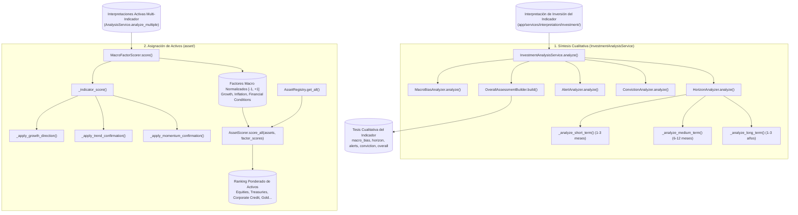

# Submódulo de Síntesis de Inversión y Asignación de Activos: `app/services/analysis/investment`

El submódulo `app/services/analysis/investment` representa la **capa final de toma de decisiones financieras** de **Sight**. Su función es doble:
1. **Síntesis Cualitativa de Inversión (`InvestmentAnalysisService`)**: Construye la tesis ejecutiva unificada para un indicador individual integrando sesgo macroeconómico, desglose por horizontes temporales (corto, medio y largo plazo), alertas de riesgo y nivel de convicción.
2. **Asignación Cuantitativa Multi-Activo (`asset/`)**: Modela el espacio macroeconómico mediante factores continuos normalizados y genera un ranking ordenado de clases de activos según su sensibilidad factorial.

---

## 1. Mapa Global de Flujo y Arquitectura

---

## 2. Capa Cualitativa: `InvestmentAnalysisService`
Archivo: [`investment_analysis_service.py`](investment_analysis_service.py)

Consume las interpretaciones procedentes de `app/services/interpretation/investment/` (`environment`, `risk`, `opportunity`, `transition`, `signals`, `confidence`, `regime`) y orquesta cinco analizadores especializados:

### 2.1. Sesgo Macroeconómico: `MacroBiasAnalyzer`
Archivo: [`macro_bias_analyzer.py`](macro_bias_analyzer.py)
* **Objetivo:** Sintetizar la postura direccional del indicador frente al ciclo de mercado:
  * `bullish`: Entorno favorable (*supportive*), riesgo bajo o moderado, y oportunidades activas.
  * `bearish`: Entorno adverso (*challenging*), riesgo elevado o alto, y oportunidades limitadas.
  * `transitioning`: Transición económica en curso hacia una nueva fase del ciclo.
  * `neutral`: Entorno estancado o señales de fuerza contraria canceladas.

### 2.2. Desglose por Horizontes Temporales: `HorizonAnalyzer`
Archivo: [`horizon_analyzer.py`](horizon_analyzer.py)
Desglosa la perspectiva temporal reconociendo que los factores de corto plazo pueden diferir de las tendencias estructurales de largo plazo:
* **Corto Plazo (`short_term`, 1 a 3 meses):**
  Dominado por la aceleración inmediata y el momentum reciente. Muy reactivo a rebotes tácticos o pérdidas bruscas de impulso.
* **Medio Plazo (`medium_term`, 6 a 12 meses):**
  Dominado por la tendencia móvil multiescala (`rolling_slope`) y las transiciones de ciclo económico.
* **Largo Plazo (`long_term`, 1 a 3 años):**
  Dominado por el régimen estructural macroeconómico y la posición histórica en la distribución de extremos (drawdown acumulado y percentil histórico).

### 2.3. Detección de Alertas y Tensión: `AlertAnalyzer`
Archivo: [`alert_analyzer.py`](alert_analyzer.py)
Identifica y clasifica eventos de estrés o rupturas de régimen:
* `volatility_shock`: Incremento súbito de volatilidad en un entorno de alta volatilidad preexistente.
* `extreme_volatility_stress`: Volatilidad $> 3\sigma$ sobre la media histórica.
* `severe_drawdown`: Corrección acumulada $> -20\%$ respecto a máximos históricos.
* `trend_reversal`: Inversión de signo en el índice sintético de tendencia.
* `growth_reversal`: Contracción de crecimiento tras un periodo expansivo.

### 2.4. Evaluación de Convicción: `ConvictionAnalyzer`
Archivo: [`conviction_analyzer.py`](conviction_analyzer.py)
Evalúa la solidez y coherencia global de la tesis final de inversión en cuatro niveles: `high`, `moderate`, `low`, `very_low`.
* No debe confundirse con `ConfidenceEstimator` (que mide la claridad estadística de los datos del indicador). `ConvictionAnalyzer` evalúa si el sesgo, los horizontes temporales y las alertas convergen en una recomendación robusta o si hay discrepancias entre plazos.

### 2.5. Síntesis Ejecutiva: `OverallAssessmentBuilder`
Archivo: [`overall_assessment_builder.py`](overall_assessment_builder.py)
Integra el sesgo macroeconómico, el horizonte temporal prioritario, las alertas de riesgo activas y el nivel de convicción en un veredicto ejecutivo unificado con justificación textual estructurada.

---

## 3. Capa Cuantitativa de Activos: `investment/asset/`

Esta capa opera a nivel multi-indicador agregado dentro de `AnalysisService.analyze_multiple()`, transformando las lecturas cualitativas en una matriz de asignación cuantitativa de activos.

### 3.1. Puntuación de Factores Macroeconómicos: `MacroFactorScorer`
Archivo: [`asset/macro_factor_scorer.py`](asset/macro_factor_scorer.py)

Convierte las interpretaciones económicas en tres factores estandarizados continuos en el intervalo $[-1.0, +1.0]$:
1. **Factor Crecimiento (`growth`)**: Refleja la aceleración o desaceleración económica agregada.
2. **Factor Inflación (`inflation`)**: Refleja la intensidad de las presiones inflacionarias o desinflacionarias.
3. **Factor Condiciones Financieras (`financial_conditions`)**: Refleja la holgura o restricción de la política monetaria y los diferenciales de crédito.

Para cada indicador, calcula una puntuación base a partir del estado cualitativo (`positive`: $+0.6$, `negative`: $-0.6$, `flat`: $0.0$) y aplica confirmaciones multiplicativas por dirección, tendencia y momentum. Finalmente normaliza las puntuaciones mediante tangentes hiperbólicas y medias ponderadas.

### 3.2. Catálogo Oficial de Activos: `AssetRegistry`
Archivo: [`asset/asset_registry.py`](asset/asset_registry.py)

Mantiene la definición canónica de las clases de activos de inversión y sus sensibilidades teóricas factoriales $\beta$:
* **Equities (Renta Variable Global / Emergente / Small Caps):**
  Alta sensibilidad positiva al factor Crecimiento ($\beta_{\text{growth}} > 0$) y sensibilidad negativa a condiciones financieras restrictivas.
* **Sovereign Bonds / Treasuries (Bonos Soberanos de Corto y Largo Plazo):**
  Sensibilidad negativa al factor Inflación ($\beta_{\text{inflation}} < 0$) y comportamiento defensivo ante caídas del crecimiento.
* **Corporate Credit (Crédito Corporativo / High Yield):**
  Sensibilidad mixta a crecimiento y condiciones financieras.
* **Gold / Commodities (Oro y Materias Primas):**
  Alta sensibilidad positiva a presiones inflacionarias ($\beta_{\text{inflation}} > 0$).
* **Cash / Liquidity:**
  Activo refugio de baja volatilidad y beta casi nula frente a factores de riesgo.

### 3.3. Modelo de Scoring de Activos: `AssetScorer`
Archivo: [`asset/asset_scorer.py`](asset/asset_scorer.py)

Aplica el producto escalar entre las sensibilidades del activo $\mathbf{\beta}_i$ y el vector de factores macroeconómicos vigentes $\mathbf{F}$:
$$\text{Score}_i = \sum_{j \in \{\text{Growth}, \text{Inflation}, \text{FinConditions}\}} \beta_{i, j} \cdot F_j$$
Normaliza los resultados en el rango $[-1.0, +1.0]$ y emite el ranking ordenado de activos con sesgo recomendado:
* $\text{Score} \ge +0.25 \rightarrow \text{overweight}$ (sobreponderar).
* $\text{Score} \le -0.25 \rightarrow \text{underweight}$ (infraponderar).
* $-0.25 < \text{Score} < +0.25 \rightarrow \text{neutral}$ (neutral / mantener).

---

## 4. Matriz de Conexiones entre Métodos

| Método Emisor | Método Receptor | Parámetros Enviados | Salida Obtenida |
| :--- | :--- | :--- | :--- |
| `AnalysisService.analyze` | `InvestmentAnalysisService.analyze` | Salida de `InvestmentInterpretationService` | Síntesis ejecutiva cualitativa del indicador. |
| `InvestmentAnalysisService.analyze` | `MacroBiasAnalyzer.analyze` | `environment`, `risk`, `opportunity`, `transition`, `regime` | Bloque `"macro_bias"` (estado, dirección, fuerza). |
| `InvestmentAnalysisService.analyze` | `HorizonAnalyzer.analyze` | `environment`, `risk`, `opportunity`, `transition`, `regime` | Bloque `"horizon"` (corto, medio, largo plazo). |
| `InvestmentAnalysisService.analyze` | `AlertAnalyzer.analyze` | `risk`, `volatility`, `position`, `trend`, `growth` | Lista estructurada de alertas de estrés activas. |
| `InvestmentAnalysisService.analyze` | `ConvictionAnalyzer.analyze` | `environment`, `risk`, `opportunity`, `confidence`, `transition` | Bloque `"conviction"` (nivel de convicción y razones). |
| `InvestmentAnalysisService.analyze` | `OverallAssessmentBuilder.build` | `macro_bias`, `horizon`, `alerts`, `conviction` | Bloque `"overall"` con veredicto ejecutivo unificado. |
| `AnalysisService.analyze_multiple` | `MacroFactorScorer.score` | `active_interpretations` | Diccionario con factores normalizados `[-1, +1]`. |
| `AnalysisService.analyze_multiple` | `AssetRegistry.get_all` | Ninguno | Lista de instancias `InvestmentAsset` configuradas. |
| `AnalysisService.analyze_multiple` | `AssetScorer.score_all` | `assets`, `factor_scores` | Lista ordenada de activos rankeados con sesgos. |

---

## 5. Batería de Pruebas Asociadas

* [`tests/unit/services/analysis/investment/test_investment_analysis_service.py`](file:///home/dano/sight/backend/tests/unit/services/analysis/investment/test_investment_analysis_service.py): Integración completa de la síntesis de inversión cualitativa.
* [`tests/unit/services/analysis/investment/test_macro_bias_analyzer.py`](file:///home/dano/sight/backend/tests/unit/services/analysis/investment/test_macro_bias_analyzer.py): Determinación del sesgo direccional y transición.
* [`tests/unit/services/analysis/investment/test_horizon_analyzer.py`](file:///home/dano/sight/backend/tests/unit/services/analysis/investment/test_horizon_analyzer.py): Consistencia táctica vs estratégica en corto, medio y largo plazo.
* [`tests/unit/services/analysis/investment/test_alert_analyzer.py`](file:///home/dano/sight/backend/tests/unit/services/analysis/investment/test_alert_analyzer.py): Detección de choques de volatilidad, drawdowns y rupturas.
* [`tests/unit/services/analysis/investment/test_conviction_analyzer.py`](file:///home/dano/sight/backend/tests/unit/services/analysis/investment/test_conviction_analyzer.py): Ponderación de la convicción analítica ante contradicciones.
* [`tests/unit/services/analysis/investment/test_overall_assessment_builder.py`](file:///home/dano/sight/backend/tests/unit/services/analysis/investment/test_overall_assessment_builder.py): Validación del reporte de síntesis ejecutiva unificada.
