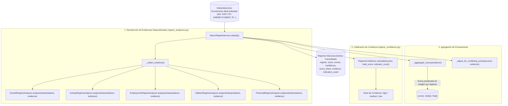

# Submódulo de Clasificación de Régimen Macroeconómico Agregado: `app/services/analysis/macro_regime`

El submódulo `app/services/analysis/macro_regime` es el motor de síntesis macroeconómica de **Sight**. Su función es agregar las interpretaciones económicas individuales de múltiples indicadores heterogéneos (crecimiento, empleo, actividad, inflación y condiciones financieras) para determinar el **régimen macroeconómico dominante** de una economía nacional o regional, su nivel de convicción y las evidencias cuantitativas que lo respaldan.

---

## 1. Mapa Global de Flujo y Agregación

---

## 2. Los 8 Regímenes Macroeconómicos Canónicos

El sistema clasifica la economía en una taxonomía de ocho regímenes mutuamente excluyentes:

| Régimen | Estado Macroeconómico | Dinámica de Señales Principales |
| :--- | :--- | :--- |
| **`expansion`** | Expansión Económica Sólida | PIB acelerando, producción industrial en crecimiento, desempleo a la baja, condiciones financieras normales o acomodaticias. |
| **`late_expansion`** | Expansión Tardía / Sobrecalentamiento | Crecimiento maduro, presiones inflacionarias elevadas, tipos de interés al alza y señales incipientes de desaceleración. |
| **`slowdown`** | Desaceleración | Crecimiento positivo pero con gradiente a la baja (*weakening/decelerating*), pérdida de impulso en actividad industrial. |
| **`stagnation`** | Estancamiento | Crecimiento económico plano o cercano a cero, sin destrucción masiva de empleo pero sin tracción expansiva. |
| **`recovery`** | Recuperación Temprana | Salida de recesión: crecimiento o actividad rebotando desde mínimos con momentum positivo y aceleración. |
| **`contraction`** | Contracción / Recesión Abierta | Crecimiento negativo, aumento del desempleo, contracción de ventas y producción industrial. |
| **`stress`** | Estrés Financiero Crítico | Choques de volatilidad extrema en tipos de interés o mercados financieros, drawdowns severos y condiciones crediticias restrictivas. |
| **`neutral`** | Neutral / No Concluyente | Empate perfecto de puntuaciones, falta de indicadores suficientes o señales mutuamente canceladas. |

---

## 3. Analizadores Especializados de Evidencia (`regime_analyzers.py`)

Cada analizador examina los indicadores de su competencia económica y emite diccionarios de evidencia con una clave obligatoria de ponderación econométrica `"weight"`:

### 3.1. `GrowthRegimeAnalyzer` (Crecimiento General)
* **Indicadores evaluados:** `GDP` (PIB real).
* **Ponderación:** `weight = 3.0` (o `2.0` si la confianza individual es media).
* **Reglas:**
  * Si el crecimiento es positivo y acelerando/mejorando $\rightarrow$ evidencia de `expansion`.
  * Si el crecimiento es positivo pero desacelerando con tendencia a la baja $\rightarrow$ `slowdown`.
  * Si el crecimiento es negativo $\rightarrow$ `contraction`.
  * Si el crecimiento es negativo pero con momentum y tendencia en clara recuperación $\rightarrow$ `recovery`.

### 3.2. `ActivityRegimeAnalyzer` (Pulso de Actividad Real)
* **Indicadores evaluados:** `INDUSTRIAL_PRODUCTION`, `RETAIL_SALES`.
* **Ponderación:** `weight = 2.0` por evidencia.
* **Reglas:**
  * Ambos en mejora $\rightarrow$ evidencia de `expansion`.
  * Ambos en deterioro $\rightarrow$ evidencia de `slowdown` (o `contraction` si el nivel ya es negativo).
  * Uno en mejora y otro en deterioro $\rightarrow$ emite evidencia de conflicto o transición.

### 3.3. `EmploymentRegimeAnalyzer` (Mercado Laboral)
* **Indicadores evaluados:** `UNEMPLOYMENT` (Tasa de desempleo), `PAYROLLS`.
* **Ponderación:** `weight = 3.0` (o `2.0`).
* **Reglas (Indicador Inverso):**
  * Desempleo cayendo con tendencia bajista $\rightarrow$ evidencia de `expansion`.
  * Desempleo subiendo con aceleración positiva $\rightarrow$ evidencia de `contraction`.
  * Desempleo estabilizado tras subidas $\rightarrow$ `stagnation`.

### 3.4. `InflationRegimeAnalyzer` (Presiones de Precios)
* **Indicadores evaluados:** `CPI`, `INFLATION`.
* **Ponderación:** `weight = 2.0`.
* **Reglas:**
  * Inflación alta y creciente en contexto de crecimiento positivo $\rightarrow$ evidencia de `late_expansion`.
  * Inflación cayendo en contexto de desaceleración $\rightarrow$ evidencia de desinflación compatible con `slowdown`.

### 3.5. `FinancialRegimeAnalyzer` (Condiciones y Tensión Financiera)
* **Indicadores evaluados:** `INTEREST_RATE`, `FINANCIAL_CONDITIONS`.
* **Ponderación:** `weight = 2.0` (o `1.5` en estrés moderado).
* **Reglas:**
  * Volatilidad extrema o shock de volatilidad en tipos $\rightarrow$ evidencia de `stress` (`weight = 2.0`).
  * Drawdown severo en condiciones de mercado $\rightarrow$ evidencia de `stress` (`weight = 3.0`).

---

## 4. Agregación, Penalización y Confianza

### 4.1. Suma Ponderada de Scores
El método `_aggregate_scores(evidence)` acumula los pesos emitidos por todos los analizadores para cada régimen:
$$\text{Score}(R) = \sum_{e \in \text{Evidence}_R} \text{weight}(e)$$
*(Cuenta con un fallback defensivo `item.get("weight", 1.0)` para garantizar que ninguna evidencia futura quede excluida en silencio)*.

### 4.2. Ajuste por Conflicto de Actividad (`_adjust_for_conflicting_activity`)
Si los indicadores de actividad económica (`INDUSTRIAL_PRODUCTION`) apuntan a una contracción severa mientras el PIB muestra crecimiento residual debido a revisiones estadísticas rezagadas, este método aplica una penalización al régimen de `expansion` y redistribuye peso hacia `slowdown` o `contraction`, evitando que un PIB desactualizado enmascare un frenazo industrial contemporáneo.

### 4.3. Calibración de Confianza (`RegimeConfidence.calculate`)
La confianza analítica mide la solidez de la mayoría frente a la dispersión total:
$$\text{Share} = \frac{\text{Score}(\text{Régimen Dominante})}{\sum_R \text{Score}(R)}$$

* **`high`**:
  * Requiere al menos 2 indicadores independientes.
  * Con 2 indicadores: $\text{Score} \ge 8.0$ y $\text{Share} \ge 65\%$.
  * Con $\ge 3$ indicadores: $\text{Score} \ge 8.0$ y $\text{Share} \ge 60\%$.
* **`medium`**:
  * Con 1 indicador: $\text{Score} \ge 4.0$ y $\text{Share} \ge 60\%$ (nunca emite `high` con un solo indicador).
  * Con 2 indicadores: $\text{Score} \ge 4.0$ y $\text{Share} \ge 50\%$.
  * Con $\ge 3$ indicadores: $\text{Score} \ge 4.0$ y $\text{Share} \ge 45\%$.
* **`low`**: Cuota insuficiente, empate perfecto o dispersión extrema entre evidencias.

---

## 5. Matriz de Conexiones entre Métodos

| Método Emisor | Método Receptor | Parámetros Enviados | Salida Obtenida |
| :--- | :--- | :--- | :--- |
| `AnalysisService.analyze_multiple` | `MacroRegimeService.classify` | `active_interpretations` (excluye `stale`) | Diccionario consolidado de régimen macroeconómico. |
| `MacroRegimeService.classify` | `MacroRegimeService._collect_evidence` | `interpretations` | Lista de diccionarios con evidencias y claves `"weight"`. |
| `_collect_evidence` | `GrowthRegimeAnalyzer.analyze` | `interpretations`, `evidence` | Añade evidencias de crecimiento con `weight = 3.0/2.0`. |
| `_collect_evidence` | `ActivityRegimeAnalyzer.analyze` | `interpretations`, `evidence` | Añade evidencias de actividad con `weight = 2.0`. |
| `_collect_evidence` | `EmploymentRegimeAnalyzer.analyze` | `interpretations`, `evidence` | Añade evidencias laborales con `weight = 3.0/2.0`. |
| `_collect_evidence` | `InflationRegimeAnalyzer.analyze` | `interpretations`, `evidence` | Añade evidencias de precios con `weight = 2.0`. |
| `_collect_evidence` | `FinancialRegimeAnalyzer.analyze` | `interpretations`, `evidence` | Añade evidencias financieras con `weight = 2.0/1.5`. |
| `MacroRegimeService.classify` | `MacroRegimeService._aggregate_scores` | `evidence` | Diccionario acumulado `scores: dict[str, float]`. |
| `MacroRegimeService.classify` | `MacroRegimeService._adjust_for_conflicting_activity` | `scores`, `evidence` | Diccionario `scores` ajustado por divergencias. |
| `MacroRegimeService.classify` | `RegimeConfidence.calculate` | `scores`, `total_score`, `indicator_count` | Nivel de confianza (`high`, `medium`, `low`). |

---

## 6. Batería de Pruebas Asociadas

* [`tests/unit/services/analysis/macro/macro_regime/test_macro_regime_service.py`](file:///home/dano/sight/backend/tests/unit/services/analysis/macro/macro_regime/test_macro_regime_service.py): Validación del pipeline de clasificación con datos sintéticos y reales, cálculo de cuotas y manejo de empates.
* [`tests/unit/services/analysis/macro/macro_regime/test_regime_analyzers.py`](file:///home/dano/sight/backend/tests/unit/services/analysis/macro/macro_regime/test_regime_analyzers.py): Pruebas aisladas para los 5 analizadores de evidencia asegurando la emisión de claves `"weight"`.
* [`tests/unit/services/analysis/macro/macro_regime/test_regime_confidence.py`](file:///home/dano/sight/backend/tests/unit/services/analysis/macro/macro_regime/test_regime_confidence.py): Reglas de umbral de cuota y cantidad de indicadores requeridos para confianza alta/media/baja.
