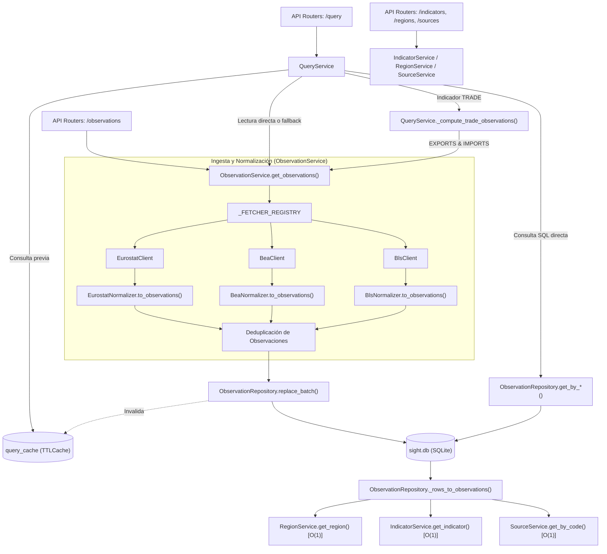

# Arquitectura Técnica y Catálogo de Datos: `app/services/catalog`

El módulo `app/services/catalog` es la infraestructura de datos base de **Sight**. Su función es modelar el universo macroeconómico (indicadores, regiones, fuentes y categorías), orquestar la ingesta y normalización desde proveedores externos oficiales (Eurostat, BEA, BLS, FRED, etc.), persistir las series en la base de datos relacional SQLite (`sight.db`) y proveer una capa de consulta rápida con soporte para cálculo sintético y caché en memoria.

---

## 1. Mapa Global de Flujo de Datos y Componentes

El siguiente diagrama detalla el ciclo de vida de los datos: desde que los proveedores externos son consultados hasta que los datos normalizados se sirven a la capa de análisis o al frontend.



---

## 2. Catálogo Canónico y Entidades

Todos los servicios del catálogo mantienen instancias únicas en memoria accesibles en tiempo constante $O(1)$ con soporte para consultas insensibles a mayúsculas y minúsculas (`.upper()`).

### 2.1. Indicadores Económicos (`IndicatorService`)
Archivo: [`indicator_service.py`](indicator_service.py)

Contiene la definición oficial de los 14 indicadores analizados en Sight:

| ID | Código | Nombre | Frecuencia | Unidad | Método de Crecimiento | Categoría |
| :--- | :--- | :--- | :--- | :--- | :--- | :--- |
| 1 | `GDP` | Gross Domestic Product | Trimestral | `billion_usd` | `log` | Economy |
| 2 | `INFLATION` | Inflation Rate | Mensual | `%` | `rate` | Economy |
| 3 | `UNEMPLOYMENT` | Unemployment Rate | Mensual | `%` | `rate` | Economy |
| 4 | `HOUSE_PRICE_INDEX` | House Price Index | Trimestral | `index` | `log` | Economy |
| 5 | `CPI` | Consumer Price Index | Mensual | `index` | `log` | Economy |
| 6 | `INTEREST_RATE` | Central Bank Interest Rate | Mensual | `%` | `rate` | Economy |
| 7 | `INDUSTRIAL_PRODUCTION` | Industrial Production Index | Mensual | `index` | `log` | Economy |
| 8 | `RETAIL_SALES` | Retail Sales Index | Mensual | `index` | `log` | Economy |
| 9 | `EXPORTS` | Exports of Goods & Services | Mensual | `billion_usd` | `log` | Economy |
| 10 | `IMPORTS` | Imports of Goods & Services | Mensual | `billion_usd` | `log` | Economy |
| 11 | `TRADE` | Trade Balance (Sintético) | Mensual | `billion_usd` | `rate` | Economy |
| 12 | `EXPORTS_BY_COUNTRY` | Exports of Goods (EU Members) | Anual | `million_eur` | `log` | Economy |
| 13 | `IMPORTS_BY_COUNTRY` | Imports of Goods (EU Members) | Anual | `million_eur` | `log` | Economy |
| 14 | `TRADE_BALANCE_BY_COUNTRY` | Trade Balance (EU Members) | Anual | `million_eur` | `rate` | Economy |

* **`get_indicators()`**: Retorna la lista inmutable de indicadores disponibles.
* **`get_indicator(code: str)`**: Búsqueda en diccionario hash $O(1)$ normalizando cadenas.

### 2.2. Regiones Geográficas (`RegionService`)
Archivo: [`region_service.py`](region_service.py)

Mapea las 16 entidades geopolíticas soportadas:
* **Unión Económica**: `EU27_2020` (Unión Europea).
* **Países**: `DE` (Alemania), `FR` (Francia), `IT` (Italia), `ES` (España), `NL` (Países Bajos), `PL` (Polonia), `BE` (Bélgica), `SE` (Suecia), `AT` (Austria), `IE` (Irlanda), `DK` (Dinamarca), `FI` (Finlandia), `CZ` (Chequia), `PT` (Portugal), `US` (Estados Unidos).

* **`get_regions()`**: Retorna las regiones configuradas.
* **`get_region(code: str)`**: Búsqueda inmediata $O(1)$ por código ISO.

### 2.3. Proveedores y Fuentes (`SourceService`)
Archivo: [`source_service.py`](source_service.py)

Define las fuentes oficiales y sus metadatos de acceso:
* `EUROSTAT`: Oficina Estadística de la Comisión Europea.
* `ECB`: Banco Central Europeo (*European Central Bank*).
* `OECD`: Organización para la Cooperación y el Desarrollo Económico.
* `FRED`: Federal Reserve Economic Data (St. Louis Fed).
* `BLS`: Bureau of Labor Statistics (EE. UU.).
* `BEA`: Bureau of Economic Analysis (EE. UU.).
* `NBS`: National Bureau of Statistics of China.

* **`get_sources()`**: Retorna la lista de fuentes registradas.
* **`get_by_code(code: str)`**: Búsqueda en $O(1)$ insensible a mayúsculas/minúsculas.

### 2.4. Categorías (`CategoryService`)
Archivo: [`category_service.py`](category_service.py)

Provee la taxonomía de alto nivel (`Economy`) vinculada a los indicadores económicos.

---

## 3. Servicio de Ingesta y Normalización: `ObservationService`

Archivo: [`observation_service.py`](observation_service.py)

Este componente se encarga de abastecer la base de datos de observaciones históricas descargando de APIs oficiales externas cuando los datos no están disponibles en la caché SQLite o cuando se solicita un refresco explícito.

### Arquitectura de Registro Dinámico (`_FETCHER_REGISTRY`)
Para evitar duplicidad y respetar el principio de Abierto/Cerrado (*Open-Closed Principle*), la asignación de proveedores por indicador se desacopla mediante un registro estático:

```python
_FETCHER_REGISTRY = {
    "GDP": [
        ("EUROSTAT", EurostatClient, "get_gdp", EurostatNormalizer),
        ("BEA", BeaClient, "get_gdp", BeaNormalizer),
    ],
    "INFLATION": [
        ("EUROSTAT", EurostatClient, "get_inflation", EurostatNormalizer),
        ("BLS", BlsClient, "get_inflation", BlsNormalizer),
    ],
    ...
}
```

### Métodos Principales

#### `ObservationService.get_observations(indicator_code, region_code=None, refresh=False)`
1. **Comprobación de Caché SQLite**:
   * Invoca `ObservationRepository.exists(indicator_code, region_code)`.
   * Si no se fuerza el refresco (`refresh=False`) y la serie solicitada ya existe para la región, consulta directamente en SQLite mediante `ObservationRepository.get_by_region_and_indicator()` haciendo uso de los índices compuestos.
2. **Descarga desde Clientes Oficiales**:
   * Si no está en SQLite o `refresh=True`, localiza los clientes y métodos correspondientes en `_FETCHER_REGISTRY`.
   * Ejecuta las llamadas y transforma la respuesta cruda en instancias estandarizadas `Observation` mediante su respectivo normalizador.
3. **Deduplicación Multidimensional**:
   * Elimina duplicados utilizando la tupla única `(region_code, indicator_code, source_code, date)`. La presencia de `source_code` garantiza que observaciones de distintas fuentes para un mismo país no se sobrescriban indebidamente.
4. **Persistencia por Lotes e Invalidación**:
   * Agrupa las observaciones únicas y las persiste en bloque llamando a `ObservationRepository.replace_by_region_indicator_source()`.
   * Invoca `query_cache.clear()` para garantizar que ninguna respuesta caducada permanezca en la capa de servicio de consultas.
5. **Filtrado Regional**:
   * Retorna la serie filtrada para el `region_code` solicitado o todas las regiones si es `None`.

---

## 4. Servicio de Consultas y Series Sintéticas: `QueryService`

Archivo: [`query_service.py`](query_service.py)

Capa de acceso orientada a servir respuestas formateadas para API REST con soporte de caché TTL en memoria (`query_cache`).

### Métodos Principales

#### `QueryService.get_by_region_and_indicator(region_code, indicator_code)`
* Devuelve la serie temporal de un indicador para un país/región empaquetada como `RegionResponse`.
* Comprueba `query_cache` en primer término para latencia sub-milisegundo.
* Si el indicador es `TRADE`, invoca `_compute_trade_observations()`.

#### `QueryService.get_by_indicator(indicator_code)`
* Devuelve las observaciones de todas las regiones disponibles para un indicador dado en formato `IndicatorResponse`.
* Si `TRADE` es solicitado, sintetiza la balanza comercial para todos los países disponibles en base a exportaciones e importaciones.

#### `QueryService.get_by_region(region_code)`
* Devuelve el catálogo completo de observaciones de un país agrupadas por indicador.

#### `QueryService.compare_regions(indicator_code, region_codes)`
* Consulta y compara las series del mismo indicador entre múltiples países/regiones simultáneamente.
* **Integridad Preservada**: Los valores de los agregados (como el PIB de la Unión Europea `EU27_2020`) se devuelven en su valor íntegro real sin mutaciones en memoria ni divisiones artificiales.

#### `QueryService._compute_trade_observations(region_code=None)`
* Método privado para la síntesis de la balanza comercial:
  $$\text{TRADE}_{r, t} = \text{EXPORTS}_{r, t} - \text{IMPORTS}_{r, t}$$
* Empareja fechas idénticas entre exportaciones e importaciones de la misma fuente y país para evitar desfases temporales.

#### `QueryService.clear_cache()`
* Vacía `query_cache` de forma síncrona.

---

## 5. Capa de Persistencia: `ObservationRepository`

Archivo: [`app/repositories/observation_repository.py`](file:///home/dano/sight/backend/app/repositories/observation_repository.py)

Gestiona la base de datos relacional SQLite (`sight.db`) sobre la tabla única `observations`.

### Esquema e Índices de Alto Rendimiento

```sql
CREATE TABLE IF NOT EXISTS observations (
    id INTEGER PRIMARY KEY AUTOINCREMENT,
    region_code TEXT NOT NULL,
    indicator_code TEXT NOT NULL,
    source_code TEXT NOT NULL,
    date TEXT NOT NULL,
    value REAL NOT NULL,
    UNIQUE (region_code, indicator_code, source_code, date)
);

CREATE INDEX IF NOT EXISTS idx_observations_indicator_region
ON observations (indicator_code, region_code);

CREATE INDEX IF NOT EXISTS idx_observations_region_indicator
ON observations (region_code, indicator_code);

CREATE INDEX IF NOT EXISTS idx_observations_indicator
ON observations (indicator_code);
```

### Métodos Principales

* **`create_table()`**: Crea la tabla y los tres índices compuestos si no existen.
* **`exists(indicator_code, region_code=None)`**: Ejecuta `SELECT 1 ... LIMIT 1` sobre los índices, deteniendo el escaneo en el primer registro coincidente ($O(1)$ en lugar de realizar conteos completos).
* **`get_by_region_and_indicator(region_code, indicator_code)`**: Recupera la serie cronológica ordenada por fecha.
* **`get_by_indicator(indicator_code)`**: Recupera todas las observaciones de todas las regiones para un indicador.
* **`replace_batch(grouped_observations)`**: Ejecuta las eliminaciones e inserciones de múltiples series dentro de una **única transacción atómica** (`BEGIN TRANSACTION ... COMMIT`). Si falla algún registro, efectúa un `ROLLBACK` completo.
* **`_rows_to_observations(rows)`**: Convierte las tuplas SQLite a modelos Pydantic `Observation`. Utiliza los diccionarios cacheados de `RegionService`, `IndicatorService` y `SourceService`, permitiendo deserializar miles de filas en milisegundos.

---

## 6. Matriz de Conexiones entre Métodos

| Método Emisor | Método Receptor | Parámetros Enviados | Salida Obtenida |
| :--- | :--- | :--- | :--- |
| `API Router: /observations` | `ObservationService.get_observations` | `indicator_code`, `region` | Lista de instancias `Observation`. |
| `API Router: /query/region/ind` | `QueryService.get_by_region_and_indicator` | `region_code`, `indicator_code` | `RegionResponse` formateado. |
| `QueryService.get_by_indicator` | `QueryService._compute_trade_observations` | `region_code=None` | Lista de `Observation` con valor `EXPORTS - IMPORTS`. |
| `QueryService._compute_trade_observations` | `ObservationService.get_observations` | `"EXPORTS"` / `"IMPORTS"`, `region_code` | Series de comercio exterior base. |
| `ObservationService.get_observations` | `ObservationRepository.exists` | `indicator_code`, `region_code` | Booleano de existencia rápida ($O(1)$). |
| `ObservationService.get_observations` | Clientes Oficiales (`EurostatClient`, `BeaClient`, `BlsClient`) | Llamada sin argumentos | Datos crudos JSON o `pd.DataFrame`. |
| `ObservationService.get_observations` | Normalizadores (`*Normalizer.to_observations`) | `data`, `indicator_code`, `source_code` | Lista estructurada `list[Observation]`. |
| `ObservationService.get_observations` | `ObservationRepository.replace_by_region_indicator_source` | `region_code`, `indicator_code`, `source_code`, `obs` | Número de filas reemplazadas. |
| `ObservationService.get_observations` | `query_cache.clear` | Ninguno | Caché de consultas reseteada. |
| `ObservationRepository._rows_to_observations` | `RegionService.get_region` | `row[0]` | Instancia singleton `Region` ($O(1)$). |
| `ObservationRepository._rows_to_observations` | `IndicatorService.get_indicator` | `row[1]` | Instancia singleton `Indicator` ($O(1)$). |
| `ObservationRepository._rows_to_observations` | `SourceService.get_by_code` | `row[2]` | Instancia singleton `Source` ($O(1)$). |

---

## 7. Optimizaciones de Rendimiento y Resolución de Errores

### 1. Aceleración de Deserialización de SQLite (16x más rápido)
* **Antes**: Cada fila de SQLite invocaba `RegionService.get_region()`, `IndicatorService.get_indicator()` y `SourceService.get_by_code()`, las cuales volvían a instanciar listas completas de modelos Pydantic en cada iteración. En una consulta de 7.870 observaciones (`INTEREST_RATE`), se creaban y destruían más de 300.000 objetos temporales, tardando **532.5 ms**.
* **Ahora**: Las entidades se almacenan en diccionarios estáticos indexados por código. La consulta y deserialización de las mismas 7.870 observaciones tarda **35.0 ms** (**16 veces más rápido**).

### 2. Índices Compuestos en SQLite
* **Antes**: La tabla solo contaba con la restricción de clave única `UNIQUE(region_code, indicator_code, source_code, date)`. Como `region_code` era el prefijo de la clave, cualquier filtro por `indicator_code` (p. ej. `exists` o `get_by_indicator`) obligaba a SQLite a realizar un escaneo secuencial (*full table scan*) sobre las más de 30.000 filas.
* **Ahora**: Se incorporaron los índices `idx_observations_indicator_region`, `idx_observations_region_indicator` e `idx_observations_indicator`, transformando las búsquedas en operaciones instantáneas por índice B-Tree.

### 3. Eliminación de Corrupción de Datos en `compare_regions`
* **Antes**: En [`QueryService.compare_regions()`](query_service.py), existía un bloque que dividía arbitrariamente `observation.value /= 27` si el indicador era `GDP` y la región era `EU27_2020`. Esto mutaba el objeto `Observation` en sitio (*in-place*), corrompiendo los datos en memoria para consultas futuras, además de aplicar una división económicamente inválida.
* **Ahora**: Se eliminó dicha alteración, asegurando que los valores devueltos correspondan a las cifras macroeconómicas oficiales sin distorsiones.

### 4. Generalización del Indicador Sintético `TRADE`
* **Antes**: El cálculo de `TRADE` solo estaba soportado en `get_by_region_and_indicator`. Las consultas agregadas por indicador (`get_by_indicator`) o comparaciones regionales (`compare_regions`) fallaban.
* **Ahora**: `QueryService._compute_trade_observations()` permite generar balances comerciales sintéticos en cualquiera de los endpoints de consulta.

### 5. Coherencia e Invalidación de Caché
* **Antes**: `ObservationService` actualizaba la base de datos sin notificar a `query_cache`, lo que provocaba que la API sirviera datos obsoletos durante 5 minutos a pesar de haberse forzado un refresco (`refresh=True`).
* **Ahora**: Cada actualización en base de datos vacía automáticamente la caché de consultas. Además, las comprobaciones de caché en `QueryService` se ejecutan al inicio de cada función, eliminando llamadas externas redundantes.
