# Arquitectura Técnica Exhaustiva y Motor de Features: `app/services/features`

El módulo `app/services/features` constituye la capa de ingeniería de características (*feature engineering*) y análisis cuantitativo primario de **Sight**. Su objetivo fundamental es transformar series temporales macroeconómicas brutas en indicadores estadísticos estandarizados, dinámicas de momentum, pendientes de regresión multiescala y señales analíticas discretas que posteriormente alimentan a los motores de ciclo (`app/services/analysis/cycle`), regímenes (`app/services/analysis/macro_regime`) e interpretación económica (`app/services/interpretation`).

---

## 1. Mapa Global de Conexiones y Flujo de Datos

El flujo de procesamiento comprende dos etapas principales coordinadas:
1. **Generación Cuantitativa Continua (`FeatureEngine`)**: Calcula métricas estadísticas numéricas organizadas en 5 familias ortogonales y las concatena en un único `pd.DataFrame`.
2. **Generación de Señales Analíticas Discretas (`FeatureAnalysisService`)**: Evalúa las series cuantitativas contra umbrales econométricos para producir un `pd.DataFrame` de señales booleanas y direccionales.

```mermaid
flowchart TD
    %% Entradas
    SERIES[("Serie Temporal (pd.Series)")] --> FE["FeatureEngine.compute()"]
    FREQ["Frecuencia (monthly, quarterly, annual)"] --> FE
    GM["GrowthMethod (LOG vs RATE)"] --> FE

    %% FeatureEngine Orquestación
    subgraph Familias_Features ["Familias de Features (FeatureEngine)"]
        FE --> LF["level_features(series, window)"]
        FE --> GF["growth_features(series, frequency, growth_method)"]
        FE --> TF["trend_features(series, short, medium, long)"]
        FE --> VF["volatility_features(series, window)"]
        FE --> EF["extreme_features(series, window)"]
    end

    %% Capa Utils
    subgraph Utilitarios_Numericos ["app/services/features/utils/"]
        LF --> ROL_M["rolling.py (rolling_mean, median, min, max, percentile, zscore)"]
        LF --> DYN_DRM["dynamics.py (distance_from_rolling_mean)"]
        
        GF --> VAL_P["validation.py (periods_per_year)"]
        GF --> TRF_LD["transformations.py (log_difference, percentage_change, cumulative_growth)"]
        GF --> DYN_MOM["dynamics.py (momentum)"]
        
        TF --> ROL_SLP["rolling.py (rolling_slope: OLS Analítico Vectorizado)"]
        TF --> DYN_ACC["dynamics.py (acceleration: 2ª diferencia)"]
        
        VF --> ROL_STD["rolling.py (rolling_std, rolling_range, rolling_zscore)"]
        VF --> DYN_VOL["dynamics.py (rolling_volatility)"]
        
        EF --> STA_ZS["statistics.py (zscore histórico global)"]
        EF --> STA_PCT["statistics.py (percentile histórico empírico)"]
        EF --> DYN_DD["dynamics.py (drawdown acumulado)"]
    end

    %% Concatenación y Análisis
    LF & GF & TF & VF & EF --> CONCAT["pd.concat(axis=1) -> DataFrame de Features"]
    CONCAT --> FAS["FeatureAnalysisService.analyze()"]

    %% Señales Resultantes
    subgraph Senales_Analiticas ["Señales Discretas (FeatureAnalysisService)"]
        FAS --> S_DIR["Crecimiento & Dirección (series_increasing, accelerating, reversal)"]
        FAS --> S_TRD["Estructura de Tendencia (bullish, bearish, mixed, neutral)"]
        FAS --> S_MOM["Dinámica de Momentum (improving, weakening)"]
        FAS --> S_VOL["Volatilidad & Shocks (high_volatility, volatility_shock)"]
        FAS --> S_EXT["Posición Extrema & Drawdown (severe_drawdown, near_high/low)"]
    end
```



---

## 2. Familias de Features Matemáticos

Cada familia se implementa en un módulo dedicado dentro de `app/services/features/` y devuelve un `pd.DataFrame` indexado estrictamente por las fechas de la serie temporal original.

### 2.1. Nivel y Posición Local: `level_features.py`
Captura el estado actual de la serie respecto a su entorno temporal inmediato mediante una ventana móvil $W$ (por defecto $W = 8$ observaciones):

| Columna | Definición Matemática / Algorítmica | Propósito Econométrico |
| :--- | :--- | :--- |
| `value` | $X_t$ | Valor nominal original de la serie en el período $t$. |
| `rolling_mean` | $\mu_{t, W} = \frac{1}{W} \sum_{i=0}^{W-1} X_{t-i}$ | Nivel promedio de equilibrio de corto plazo. |
| `rolling_median` | $\text{mediana}(X_{t-W+1}, \dots, X_t)$ | Centro de gravedad robusto frente a *outliers* puntuales. |
| `rolling_min` | $\min_{0 \le i < W} X_{t-i}$ | Soporte local dentro de la ventana de referencia. |
| `rolling_max` | $\max_{0 \le i < W} X_{t-i}$ | Resistencia local dentro de la ventana de referencia. |
| `rolling_percentile` | $\frac{1}{W} \sum_{i=0}^{W-1} \mathbb{I}(X_{t-i} \le X_t)$ | Rango percentil dentro de la ventana ($0.0$ a $1.0$). |
| `rolling_zscore` | $\frac{X_t - \mu_{t, W}}{\sigma_{t, W}}$ | Desviación tipificada respecto a la volatilidad local. |
| `distance_from_rolling_mean` | $\frac{X_t - \mu_{t, W}}{\vert \mu_{t, W} \vert}$ | Distancia normalizada porcentual respecto a la media móvil. |

---

### 2.2. Crecimiento y Variación: `growth_features.py`
Calcula la tasa de variación, expansión acumulada y velocidad de cambio, diferenciando estrictamente entre variables continuas positivas (`GrowthMethod.LOG`) y variables de tasa o saldo (`GrowthMethod.RATE`):

#### Rama A: Series de Nivel (`GrowthMethod.LOG`, e.g., PIB real, IPC, Producción Industrial)
- **`log_difference`**: $\ln(X_t) - \ln(X_{t-1})$. Tasa de crecimiento instantáneo continuo.
- **`percentage_change`**: $\frac{X_t - X_{t-1}}{X_{t-1}}$. Crecimiento porcentual discreto período a período.
- **`cumulative_growth`**: Crecimiento porcentual acumulado móvil sobre el ciclo anual ($P$ períodos).
- **`momentum`**: $\frac{X_t - X_{t-k}}{X_{t-k}}$, donde $k$ se parametriza según frecuencia (`monthly: 3`, `quarterly: 2`, `annual: 2`).
- **`yoy_growth`**: $\frac{X_t - X_{t-P}}{X_{t-P}}$, donde $P$ son los períodos por año (`monthly: 12`, `quarterly: 4`, `annual: 1`).
- **`yoy_log_growth`**: $\ln(X_t) - \ln(X_{t-P})$. Crecimiento interanual continuo en escala logarítmica.

#### Rama B: Series de Tasa y Saldo (`GrowthMethod.RATE`, e.g., Tipos de Interés, Desempleo, Balanza Comercial)
Las series que representan porcentajes o pueden cruzar por cero no admiten logaritmos ni divisiones por niveles cercanos a cero:
- **`change`**: $\Delta X_t = X_t - X_{t-1}$. Variación absoluta en puntos porcentuales (p.p.).
- **`yoy_change`**: $\Delta_P X_t = X_t - X_{t-P}$. Variación interanual en puntos porcentuales.
- **`momentum`**: $\Delta_k X_t = X_t - X_{t-k}$. Impulso reciente en puntos porcentuales sin distorsión de cruce por cero.

---

### 2.3. Tendencia Multiescala y Aceleración: `trend_features.py`
Modela la trayectoria del indicador a través de múltiples horizontes de tiempo ($W_{\text{short}}=4$, $W_{\text{medium}}=8$, $W_{\text{long}}=16$):

```
                       Ventana Corta (W_short = 4)   ──> rolling_slope_short
                      ────────────────────────────────
                       Ventana Media (W_medium = 8)  ──> rolling_slope_medium
                      ─────────────────────────────────────────────────
                       Ventana Larga (W_long = 16)   ──> rolling_slope_long
                      ──────────────────────────────────────────────────────────────────
```

- **`rolling_slope_short / medium / long`**: Pendientes $\beta_1$ calculadas mediante OLS analítico sobre cada ventana.
- **`acceleration`**: Segunda diferencia temporal de la serie:
  $$\text{acceleration}_t = (X_t - X_{t-1}) - (X_{t-1} - X_{t-2})$$
- **`slope_change`**: Variación marginal de la pendiente de corto plazo: $\beta_{1, \text{short}, t} - \beta_{1, \text{short}, t-1}$.
- **`trend_change`**: Índice sintético normalizado continuo $[-1.0, +1.0]$:
  $$\text{trend\_diff} = 0.6 \cdot (\beta_{\text{short}} - \beta_{\text{medium}}) + 0.4 \cdot (\beta_{\text{short}} - \beta_{\text{long}})$$
  $$\text{trend\_scale} = \vert \beta_{\text{short}} \vert + \vert \beta_{\text{medium}} \vert + \vert \beta_{\text{long}} \vert$$
  $$\text{trend\_change} = \text{clip}\left(\frac{\text{trend\_diff}}{\text{trend\_scale}}, -1.0, +1.0\right)$$
  *(Si la serie es completamente plana y $\text{trend\_scale} = 0$, se resuelve de forma robusta como $0.0$ en lugar de producir indeterminaciones `NaN`)*.

---

### 2.4. Volatilidad y Dispersión: `volatility_features.py`
Monitorea la estabilidad y el riesgo de dispersión de la serie:
- **`rolling_std`**: Desviación estándar de los niveles nominales sobre la ventana $W$.
- **`rolling_volatility`**: Desviación estándar móvil de los retornos porcentuales ($\sigma(\Delta \% X_t)$).
- **`rolling_range`**: Amplitud entre el extremo superior e inferior local ($\max_{W} - \min_{W}$).
- **`volatility_change`**: Primera diferencia de la volatilidad móvil ($\text{volatility}_t - \text{volatility}_{t-1}$).
- **`volatility_zscore`**: Z-score móvil de la volatilidad reciente respecto a su propia media y dispersión histórica móvil.

---

### 2.5. Extremos Históricos y Caídas: `extreme_features.py`
Evalúa la posición de la observación en el contexto histórico global y detecta correcciones severas:
- **`zscore`**: Puntuación típica global considerando la media y desviación estándar de todo el historial.
- **`percentile`**: Rango percentil acumulado sobre toda la distribución histórica ($0.0$ a $1.0$).
- **`distance_from_max`**: Distancia porcentual al máximo reciente de la ventana: $\frac{X_t - \max_W(X)}{\vert \max_W(X) \vert}$.
- **`distance_from_min`**: Distancia porcentual al mínimo reciente de la ventana: $\frac{X_t - \min_W(X)}{\vert \min_W(X) \vert}$.
- **`drawdown`**: Caída acumulada porcentual respecto al máximo histórico acumulado (*running maximum*):
  $$\text{drawdown}_t = \frac{X_t - \max_{0 \le s \le t}(X_s)}{\vert \max_{0 \le s \le t}(X_s) \vert}$$

---

## 3. Submódulo `utils/` y Optimizaciones Numéricas

Los métodos auxiliares en `app/services/features/utils/` proporcionan algoritmos vectorizados de alto rendimiento y validaciones estrictas:

### 3.1. OLS Analítico Vectorizado en `rolling.py`
Tradicionalmente, el cálculo de pendientes móviles sobre ventanas deslizantes se efectúa invocando `np.polyfit()` dentro de un bucle de Pandas. Esta aproximación incurre en un coste de asignación dinámica de memoria y resolución matricial de mínimos cuadrados de complejidad elevada:

* **Optimización Implementada**: Para una ventana de tamaño fijo $W$ con abscisas temporales ordinales $t \in [0, \dots, W-1]$, la media $\bar{t} = \frac{W-1}{2}$ y el denominador $\sum (t - \bar{t})^2 = \frac{W(W^2 - 1)}{12}$ son constantes analíticas invariantes.
* La pendiente $\beta_1$ se reduce de forma exacta al producto escalar (*dot product*):
  $$\beta_1 = \mathbf{w} \cdot \mathbf{y} \quad \text{donde} \quad w_i = \frac{i - \frac{W-1}{2}}{\sum_{j=0}^{W-1} (j - \frac{W-1}{2})^2}$$
* **Resultado**: Aceleración superior a **150x** (de $89.6\,\text{ms}$ a $0.6\,\text{ms}$ en series de 10.000 observaciones) con coincidencia numérica exacta a nivel de épsilon de máquina ($3.33 \times 10^{-16}$).

### 3.2. Percentil Móvil con `raw=True`
El método `rolling_percentile()` ejecutaba funciones personalizadas sobre objetos `pd.Series` individuales (`raw=False`), obligando a Pandas a instanciar miles de series temporales con índices auxiliares.
* Se reescribió utilizando arrays 1D contiguos de NumPy (`raw=True`):
  ```python
  def percentile(values: np.ndarray) -> float:
      valid = values[~np.isnan(values)]
      if valid.size == 0:
          return np.nan
      current = valid[-1]
      return float((valid <= current).sum() / valid.size)
  ```
* **Resultado**: Reducción de tiempo de cómputo de $298.8\,\text{ms}$ a $9.5\,\text{ms}$ (**30x más rápido**).

### 3.3. Protección contra Desbordamiento y División por Cero
En `dynamics.py`, `extreme_features.py` y `transformations.py`:
* Denominadores protegidos con `.abs().replace(0.0, np.nan)`.
* Reemplazo sistemático de `[np.inf, -np.inf]` por `np.nan` para garantizar que todos los DataFrames resultantes serialicen limpiamente en JSON conforme a los estándares de la API REST de FastAPI.

---

## 4. Señales Analíticas: `FeatureAnalysisService`

`FeatureAnalysisService` procesa el DataFrame devuelto por `FeatureEngine` y genera un catálogo exhaustivo de señales booleanas sin recomputar variables continuas.

### 4.1. Parámetros y Umbrales Econométricos
```python
SLOPE_EPSILON = 1e-10                   # Tolerancia para pendiente no nula
STRONG_TREND_CHANGE_THRESHOLD = 0.50     # Umbral de aceleración de tendencia
HIGH_VOLATILITY_ZSCORE = 2.0             # Desviación de volatilidad alta (+2 sigma)
EXTREME_VOLATILITY_ZSCORE = 3.0          # Desviación de volatilidad extrema (+3 sigma)
HIGH_VOLATILITY_MULTIPLIER = 1.5         # Multiplicador sobre media móvil de volatilidad
SIGNIFICANT_DRAWDOWN = -0.10             # Corrección del 10%
SEVERE_DRAWDOWN = -0.20                  # Corrección del 20%
NEAR_HIGH_THRESHOLD = -0.05              # A menos del 5% del máximo reciente
NEAR_LOW_THRESHOLD = 0.05                # A menos del 5% del mínimo reciente
```

### 4.2. Catálogo de Señales Generadas
1. **Dinámica de Crecimiento y Dirección**:
   - `series_increasing` / `series_decreasing`: Dirección inmediata de la serie.
   - `positive_growth` / `negative_growth`: Señal de crecimiento (porcentual en LOG, variación en RATE).
   - `accelerating_growth` / `decelerating_growth`: Segunda derivada positiva o negativa.
   - `growth_reversal`: Cruce de crecimiento positivo a negativo o viceversa.
2. **Estructura y Régimen de Tendencia**:
   - `bullish_trend`: Todas las pendientes temporales disponibles ($\ge 2$) son positivas.
   - `bearish_trend`: Todas las pendientes temporales disponibles ($\ge 2$) son negativas.
   - `mixed_trend`: Discrepancia direccional entre los plazos corto, medio y largo.
   - `neutral_trend`: Todas las pendientes se encuentran dentro del rango nulo $[-\epsilon, +\epsilon]$.
   - `short_term_bullish` / `bearish`, `medium_term_bullish` / `bearish`, `long_term_bullish` / `bearish`.
   - `trend_strengthening` / `weakening`: Incremento o reducción del gradiente de corto plazo.
   - `trend_reversal`: Inversión de signo en el índice sintético `trend_change`.
3. **Momentum**:
   - `positive_momentum` / `negative_momentum`: Posición del momentum sobre o bajo cero.
   - `momentum_improving` / `weakening`: Primera diferencia del momentum.
4. **Riesgo y Volatilidad**:
   - `high_volatility`: Volatilidad $> 2\sigma$ o $> 1.5 \times \text{media histórica}$.
   - `extreme_volatility`: Volatilidad $> 3\sigma$.
   - `volatility_increasing` / `decreasing`: Evolución del régimen de dispersión.
   - `volatility_shock`: Incremento súbito de volatilidad en un entorno de alta volatilidad preexistente.
5. **Extremos y Recuperación**:
   - `significant_drawdown`: Caída superior al $-10\%$.
   - `severe_drawdown`: Caída superior al $-20\%$.
   - `near_historical_high` / `near_historical_low`: Proximidad a los bordes superior/inferior locales ($\pm 5\%$).
   - `historical_extreme_high`: Percentil empírico global $\ge 0.95$.
   - `historical_extreme_low`: Percentil empírico global $\le 0.05$.
   - `recovering_from_drawdown`: Drawdown negativo pero con diferencial positivo respecto al período anterior.
   - `falling_from_high`: La serie se aleja de máximos históricos recientes.

---

## 5. Batería de Pruebas y Cobertura de Integración

El conjunto de pruebas automatizadas garantiza la corrección numérica y matemática del módulo a través de 198 tests dedicados:

```
tests/unit/services/features/
├── test_extreme_features.py       # Cobertura de zscore, percentile, distancias a min/max y signos en negativos
├── test_feature_engine.py          # Verificación de concatenación, argumentos y parámetros de ventana
├── test_growth_features.py         # Crecimiento LOG vs RATE, momentum no distorsionado, frecuencias
├── test_level_features.py          # Niveles medios, percentil móvil, distancias móviles y z-scores
├── test_trend_features.py          # Pendientes multiescala, aceleración, cambio relativo y series planas
├── test_volatility_features.py     # Dispersión móvil, rango, deltas de volatilidad y z-score
└── utils/
    ├── test_dynamics.py            # Aceleración, volatilidad de retornos, drawdown y momentum
    ├── test_rolling.py             # Verificación OLS analítico, percentiles móviles, ventanas móviles
    ├── test_statistics.py         # Z-scores globales y rangos percentiles empíricos
    ├── test_transformations.py    # Log-diferencias, tasas discretas, protección contra infinitos
    └── test_validation.py         # Control de frecuencias, monotonicidad y validación de tipos

tests/integration/features/
├── test_feature_analysis_scenarios.py  # Pipeline completo FeatureEngine -> FeatureAnalysisService
├── test_feature_edge_cases.py          # Manejo de NaNs iniciales, ventanas mínimas, series constantes
├── test_feature_invariants.py          # Verificación de propiedades matemáticas invariantes
├── test_feature_macro_series.py        # Comportamiento con series reales de PIB, inflación y tipos
└── test_feature_scenarios.py           # Escenarios de choques, ciclos y transiciones de tendencia
```

Para ejecutar las pruebas del módulo:
```bash
PYTHONPATH=backend backend/.venv/bin/pytest backend/tests/unit/services/features/ backend/tests/integration/features/
```
