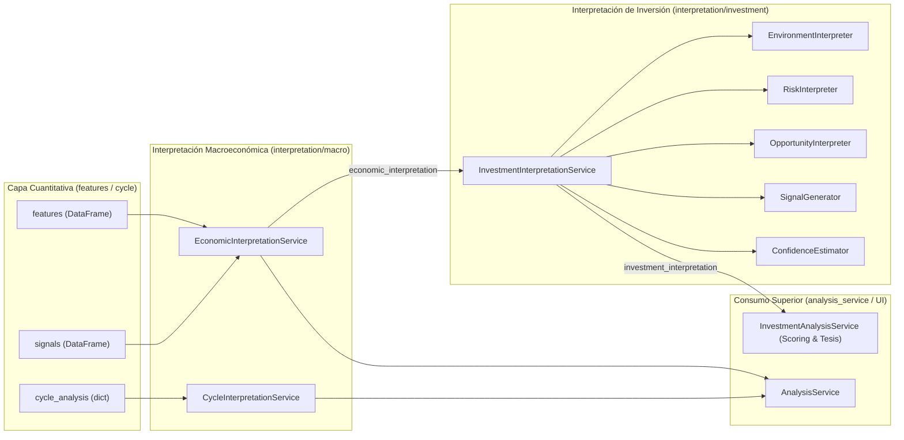

# Módulo de Interpretación (`app/services/interpretation`)

El módulo `app/services/interpretation` representa la capa de **inteligencia semántica y síntesis analítica** de **Sight**. Su cometido es transformar las matrices de características estadísticas y señales cuantitativas provenientes de `app/services/features` y `app/services/analysis/cycle` en conocimiento estructurado, separable en dos dominios complementarios:

1. **Interpretación Macroeconómica Pura ([`macro/`](file:///home/dano/sight/backend/app/services/interpretation/macro/README.md))**: Evaluación descriptiva y neutral del ciclo económico, tendencia, momentum, volatilidad, posición histórica y regímenes.
2. **Interpretación de Inversión ([`investment/`](file:///home/dano/sight/backend/app/services/interpretation/investment/README.md))**: Traducción de la semántica económica a un marco operativo de toma de decisiones de inversión (entorno, riesgos, oportunidades, señales y confianza analítica).

---

## 1. Arquitectura Global de Interpretación



---

## 2. Estructura de Directorios

```
app/services/interpretation/
├── __init__.py                # Exportaciones principales del módulo
├── constants.py               # Conjunto canónico REQUIRED_FEATURES y REQUIRED_SIGNALS
├── utils.py                   # Utilidades: safe_float, safe_bool, serialize
├── README.md                  # Arquitectura global de interpretación
├── README_ERRORES.md          # Registro global de auditorías y correcciones
│
├── macro/                     # Dominio Macroeconómico Puro
│   ├── __init__.py            # Exportaciones de intérpretes macro
│   ├── economic_interpretation_service.py # Orquestador y validador de contratos
│   ├── growth_interpreter.py  # Crecimiento y variación (LOG vs RATE)
│   ├── trend_interpreter.py   # Estructura temporal y pendientes multiescala
│   ├── momentum_interpreter.py# Dinámica de aceleración e impulso
│   ├── volatility_interpreter.py # Estrés y choques de volatilidad
│   ├── position_interpreter.py# Percentiles, medias y drawdowns
│   ├── transition_detector.py # Motor de evidencia y detección de transiciones
│   ├── regime_classifier.py   # Clasificación de los 7 regímenes macro
│   ├── assessment_builder.py  # Resumen semántico y coherencia estructural
│   ├── cycle_interpretation_service.py # Interpretación de ciclos espectrales
│   ├── README.md              # Documentación detallada del submódulo macro
│   └── README_ERRORES.md      # Registro de errores y bugs del submódulo macro
│
└── investment/                # Dominio de Inversión
    ├── __init__.py            # Exportaciones de intérpretes de inversión
    ├── investment_interpretation_service.py # Orquestador de inversión
    ├── environment_interpreter.py # Clasificación de entorno para asignación
    ├── risk_interpreter.py    # Catálogo de riesgos macroeconómicos
    ├── opportunity_interpreter.py # Catálogo de oportunidades y ventanas de entrada
    ├── signal_generator.py    # Generación de señales discretas booleanas
    ├── confidence_estimator.py# Estimador de confianza y detección de divergencias
    ├── README.md              # Documentación detallada del submódulo investment
    └── README_ERRORES.md      # Registro de errores del submódulo investment
```

---

## 3. Principios de Diseño y Contratos

1. **Separación de Responsabilidades**:  
   Ningún componente de `macro/` recomienda activos, ponderaciones o estrategias de cartera. Del mismo modo, ningún componente de `investment/` recalcula pendientes, medias móviles o transformaciones estadísticas.
2. **Resiliencia ante Valores Nulos (`None` / `NaN`)**:  
   Todas las funciones numéricas y booleanas emplean utilidades defensivas (`safe_float()`, `safe_bool()`, `serialize()`). La presencia de lagunas temporales o ventanas incompletas produce estados descriptivos degradados (`"unknown"`, `"limited"`, `None`) sin interrumpir la ejecución mediante excepciones no controladas.
3. **Serialización Canónica**:  
   Todas las fechas se normalizan a formato ISO 8601 (`YYYY-MM-DDTHH:MM:SS`), los escalares NumPy se extraen a tipos nativos de Python (`float`, `int`, `bool`) y los nulos se homogeneizan a `None` para compatibilidad directa con JSON / Pydantic.
