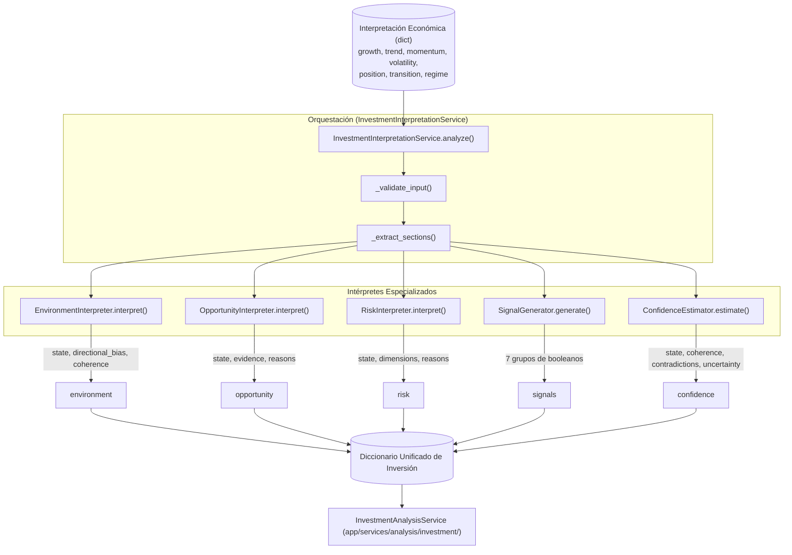

# Arquitectura Técnica y Dimensión de Inversión: `app/services/interpretation/investment`

El submódulo `app/services/interpretation/investment` constituye la capa de **interpretación macroeconómica orientada a inversión** de **Sight**. Su propósito es transformar la semántica económica pura producida por `EconomicInterpretationService` en un marco estructurado de toma de decisiones de inversión compuesto por cinco dimensiones clave: entorno (*environment*), riesgo (*risk*), oportunidad (*opportunity*), señales discretas (*signals*) y confianza analítica (*confidence*).

---

## 1. Alcance, Principios y Delimitación de Responsabilidad

Para mantener la integridad arquitectónica, este módulo se rige por delimitaciones estrictas:

* **Lo que SÍ hace:**
  * Traduce estados económicos en diagnósticos de favorabilidad de mercado (*supportive*, *challenging*, *transitioning*).
  * Evalúa la fragilidad y vulnerabilidad macroeconómica combinando 6 dimensiones de riesgo.
  * Identifica condiciones compatibles con oportunidades sin confundir "niveles bajos" con "oportunidad de compra".
  * Detecta contradicciones entre señales cruzadas (ej. crecimiento positivo vs tendencia bajista) para calibrar la confianza.
  * Provee un mapa desacoplado de señales booleanas libres de ambigüedad.
* **Lo que NO hace:**
  * NO calcula *features* ni obtiene observaciones (responsabilidad de `FeatureEngine`).
  * NO realiza valoración fundamental ni descuento de flujos.
  * NO selecciona activos ni genera recomendaciones operativas `BUY` / `SELL`.
  * NO construye carteras ni optimiza pesos (responsabilidad de `InvestmentAnalysisService` y `AssetScorer`).

```
       FeatureEngine ──> FeatureAnalysisService ──> EconomicInterpretationService
                                                            │
                                                            ▼
                                             InvestmentInterpretationService
                                                            │
                                                            ▼
                                                 InvestmentAnalysisService
```

---

## 2. Mapa Global de Flujo y Componentes



---

## 3. Catálogo de Componentes Especializados

### 3.1. Orquestador: `InvestmentInterpretationService`
Archivo: [`investment_interpretation_service.py`](investment_interpretation_service.py)

Valida que el diccionario de entrada contenga obligatoriamente las 7 secciones canónicas:
`{"growth", "trend", "momentum", "volatility", "position", "transition", "regime"}`.
Despacha de forma síncrona hacia los cinco evaluadores y retorna la estructura consolidada incorporando metadatos (`indicator`, `region`, `date`).

---

### 3.2. Intérprete del Entorno: `EnvironmentInterpreter`
Archivo: [`environment_interpreter.py`](environment_interpreter.py)

Sintetiza la postura global del contexto macroeconómico sin reinterpretar los componentes numéricos individuales:

#### A. Estados de Entorno (`state`)
* **`supportive`**: Régimen favorable de expansión o recuperación con sesgo no deteriorado.
* **`challenging`**: Régimen adverso de contracción o desaceleración (*slowdown*).
* **`transitioning`**: Régimen formalmente expansivo pero con transición moderada/fuerte hacia desaceleración o sesgo en claro deterioro.
* **`neutral`**: Entorno estancado (*stagnation*) o sin dirección dominante.

#### B. Sesgo Direccional Agregado (`directional_bias`)
Evalúa la dirección conjunta de `growth`, `trend` y `momentum`:
* `improving`: Al menos 2 de las 3 dimensiones están mejorando y superan a las que se deterioran.
* `deteriorating`: Al menos 2 de las 3 dimensiones están empeorando y superan a las que mejoran.
* `stable`: La mayoría de las dimensiones permanecen estables.
* `mixed`: Conflicto abierto entre dimensiones en mejora y en deterioro.
* `unknown`: Información direccional insuficiente o ausente.

#### C. Coherencia Direccional (`coherence`)
* `high`: Las tres dimensiones coinciden unánimemente en la misma dirección.
* `low`: Coexisten señales de mejora y deterioro simultáneamente.
* `medium`: Casos intermedios con estabilidad o mezcla parcial.

---

### 3.3. Intérprete de Oportunidades: `OpportunityInterpreter`
Archivo: [`opportunity_interpreter.py`](opportunity_interpreter.py)

Identifica condiciones macroeconómicas favorables o puntos de inflexión tempranos:

#### A. Estados de Oportunidad (`state`)
* **`established`**: Régimen de recuperación/expansión respaldado por al menos 3 evidencias de mejora y sin shocks de volatilidad.
* **`emerging`**: Transición moderada/fuerte hacia recuperación/expansión, o aceleración temprana de variables directas.
* **`supportive`**: Crecimiento positivo, tendencia alcista y momentum positivo en ausencia de estrés.
* **`limited`**: Evidencia favorable escasa o neutral.
* **`uncertain`**: Presencia de estrés extremo o shock de volatilidad que anula la visibilidad favorable.

> [!IMPORTANT]
> **Principio de Asimetría en Posición Extrema:**
> Estar en una posición históricamente baja (`lower_extreme` o drawdown severo) **NO se clasifica automáticamente como oportunidad**. Solo se considera evidencia contextual positiva si va acompañada de una recuperación activa en la dirección (`direction == "recovering"`).

---

### 3.4. Intérprete de Riesgo: `RiskInterpreter`
Archivo: [`risk_interpreter.py`](risk_interpreter.py)

Estructura la fragilidad del indicador evaluando 6 dimensiones ortogonales:

```
                  ┌───────────────┐
                  │ Growth Risk   │ ──> negative_growth, deteriorating...
                  ├───────────────┤
                  │ Trend Risk    │ ──> bearish_trend, reversing...
                  ├───────────────┤
                  │ Momentum Risk │ ──> negative_momentum, deteriorating...
  Risk Dimensions ├───────────────┤
                  │ Volatility    │ ──> volatility_shock, extreme_stress...
                  ├───────────────┤
                  │ Position Risk │ ──> severe_drawdown, falling...
                  ├───────────────┤
                  │ Transition    │ ──> contraction_transition...
                  └───────────────┘
```

#### A. Clasificación del Estado de Riesgo (`state`)
* **`high`**: Presencia de cualquier **condición severa**:
  * Crecimiento negativo en deterioro (`negative_growth_deteriorating`).
  * Tendencia bajista en deterioro (`bearish_trend_deteriorating`).
  * Momentum negativo en deterioro (`negative_momentum_deteriorating`).
  * Estrés extremo de volatilidad o shock de volatilidad (`volatility_shock`).
  * Drawdown severo (`severe_drawdown`).
  * Transición fuerte hacia contracción (`strong_contraction_transition`).
* **`elevated`**: Presencia de 2 o más **condiciones moderadas** (tendencia bajista, crecimiento desacelerando, volatilidad elevada, etc.).
* **`moderate`**: Presencia de 1 condición moderada, o régimen adverso (`slowdown`, `stagnation`, transición a deterioro).
* **`low`**: Ninguna condición de riesgo activa.

---

### 3.5. Estimador de Confianza: `ConfidenceEstimator`
Archivo: [`confidence_estimator.py`](confidence_estimator.py)

Mide la coherencia interna de la información analítica. **No representa probabilidad de ganancia financiera**, sino la fiabilidad y solidez del diagnóstico macroeconómico:

#### A. Matriz de Contradicciones Cruzadas
Detecta incoherencias entre dimensiones que reducen la confianza analítica:
1. `positive_growth_vs_bearish_trend`: Crecimiento nominal positivo en conflicto con tendencia estructural bajista.
2. `negative_growth_vs_bullish_trend`: Crecimiento negativo en conflicto con tendencia estructural alcista.
3. `positive_growth_vs_negative_momentum`: Crecimiento positivo pero con impulso desacelerando en negativo.
4. `negative_growth_vs_positive_momentum`: Crecimiento negativo pero con impulso reciente positivo.
5. `bullish_trend_vs_negative_momentum`: Divergencia estructural entre tendencia de fondo y momentum reciente.
6. `bearish_trend_vs_positive_momentum`: Divergencia estructural entre tendencia bajista y rebote de corto plazo.

#### B. Niveles de Confianza (`state`)
* **`high`**: Alta coherencia, cero contradicciones, máxima visibilidad ($\le 1$ factor de incertidumbre) y sin transiciones mixtas.
* **`moderate`**: Coherencia media/alta con a lo sumo 1 contradicción menor y estado de transición conocido.
* **`low`**: Coherencia baja, $\ge 2$ contradicciones cruzadas o $\ge 5$ factores de incertidumbre.
* **`very_low`**: Régimen desconocido o ausencia de datos en los estados centrales (`growth`, `trend`, `momentum`).

---

### 3.6. Generador de Señales: `SignalGenerator`
Archivo: [`signal_generator.py`](signal_generator.py)

Genera un diccionario exhaustivo de banderas booleanas organizadas en 7 dominios:
* `growth`: `positive`, `negative`, `flat`, `improving`, `deteriorating`, `stable`, `accelerating`, `decelerating`, `reversal`.
* `trend`: `bullish`, `bearish`, `neutral`, `mixed`, `strengthening`, `weakening`, `strong`, `moderate`, `weak`, `reversal`.
* `momentum`: `positive`, `negative`, `neutral`, `improving`, `deteriorating`, `acceleration_positive`, `acceleration_negative`.
* `volatility`: `normal`, `high`, `extreme`, `rising`, `falling`, `stress_normal`, `stress_elevated`, `stress_extreme`, `shock`.
* `position`: `upper_extreme`, `upper`, `middle`, `lower`, `lower_extreme`, `recovering`, `falling`, `significant_drawdown`, `severe_drawdown`.
* `transition`: `detected`, `toward_slowdown`, `toward_contraction`, `toward_recovery`, `toward_expansion`, `mixed`, `unknown`, `early`, `moderate`, `strong`, `none`.
* `regime`: `expansion`, `late_expansion`, `slowdown`, `stagnation`, `recovery`, `contraction`, `neutral`.

---

## 4. Matriz de Conexiones entre Métodos

| Método Emisor | Método Receptor | Parámetros Enviados | Salida Obtenida |
| :--- | :--- | :--- | :--- |
| `AnalysisService.analyze` | `InvestmentInterpretationService.analyze` | `economic_interpretation` | Diccionario consolidado de interpretación de inversión. |
| `InvestmentInterpretationService.analyze` | `EnvironmentInterpreter.interpret` | `growth`, `trend`, `momentum`, `volatility`, `position`, `transition`, `regime` | Bloque `"environment"` con estado, sesgo y contexto. |
| `InvestmentInterpretationService.analyze` | `OpportunityInterpreter.interpret` | `growth`, `trend`, `momentum`, `volatility`, `position`, `transition`, `regime` | Bloque `"opportunity"` con estado, evidencias y razones. |
| `InvestmentInterpretationService.analyze` | `RiskInterpreter.interpret` | `growth`, `trend`, `momentum`, `volatility`, `position`, `transition`, `regime` | Bloque `"risk"` con estado y 6 dimensiones de riesgo. |
| `InvestmentInterpretationService.analyze` | `SignalGenerator.generate` | `growth`, `trend`, `momentum`, `volatility`, `position`, `transition`, `regime` | Bloque `"signals"` con 7 grupos de banderas booleanas. |
| `InvestmentInterpretationService.analyze` | `ConfidenceEstimator.estimate` | `growth`, `trend`, `momentum`, `volatility`, `position`, `transition`, `regime` | Bloque `"confidence"` con estado, coherencia y contradicciones. |
| `InvestmentInterpretationService.analyze` | `InvestmentAnalysisService.analyze` | Salida completa de `InvestmentInterpretationService` | Síntesis ejecutiva de inversión (`macro_bias`, `horizon`, `alerts`, `conviction`, `overall`). |

---

## 5. Batería de Pruebas y Cobertura

El submódulo cuenta con una cobertura integral de **256 pruebas unitarias**:

```
tests/unit/services/interpretation/investment/
├── test_investment_interpretation_service.py   # Validación de orquestación, contratos y manejo de None
├── test_environment_interpreter.py             # Clasificación de entorno, sesgo direccional y coherencia
├── test_opportunity_interpreter.py             # Detección de oportunidades, acumulación de razones y asimetría
├── test_risk_interpreter.py                    # 6 dimensiones de riesgo, condiciones severas vs moderadas
├── test_confidence_estimator.py                # Coherencia, contradicciones cruzadas, incertidumbre y empates
└── test_signal_generator.py                    # Cobertura exhaustiva de las 50+ banderas booleanas y normalización
```

Para ejecutar las pruebas del submódulo:
```bash
PYTHONPATH=backend backend/.venv/bin/pytest backend/tests/unit/services/interpretation/investment/
# 256 passed in 0.26s
```
