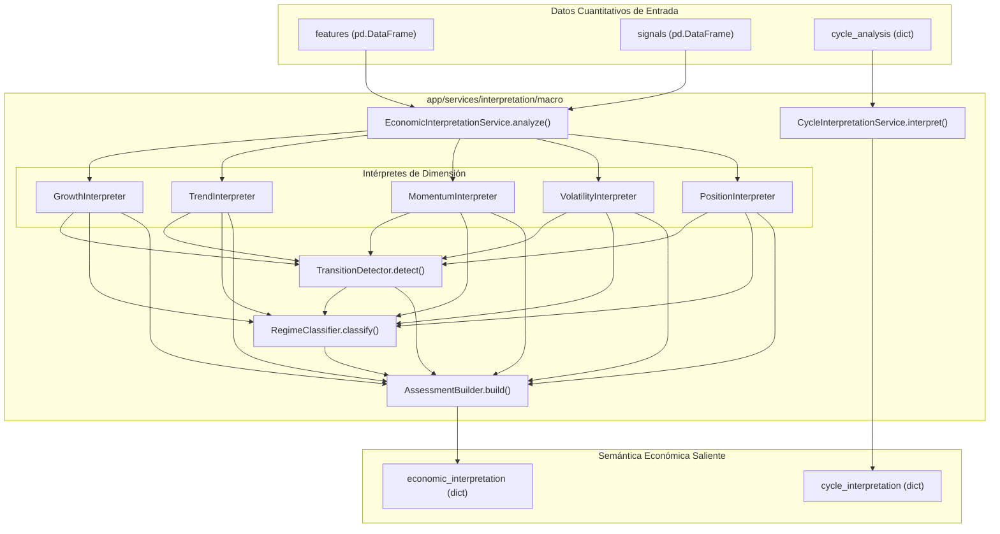

# Módulo de Interpretación Macroeconómica (`macro`)

El submódulo `app/services/interpretation/macro` constituye la capa central de **interpretación económica cuantitativa** de **Sight**. Su objetivo fundamental es transformar las métricas estadísticas puras y señales discretas (calculadas por [`FeatureEngine`](file:///home/dano/sight/backend/app/services/features/feature_engine.py) y [`CycleAnalysisService`](file:///home/dano/sight/backend/app/services/analysis/cycle/cycle_analysis_service.py)) en una representación semántica rigurosa del estado macroeconómico, libre de sesgos de inversión o recomendaciones operativas.

---

## 1. Arquitectura y Flujo de Información

---

## 2. Componentes y Responsabilidades

### 2.1 [`EconomicInterpretationService`](file:///home/dano/sight/backend/app/services/interpretation/macro/economic_interpretation_service.py)
* **Función**: Orquestador principal y validador de contratos.
* **Validaciones**:
  - Verifica que `features` y `signals` sean DataFrames no vacíos y compartan exactamente el mismo índice temporal.
  - Comprueba la presencia de las 23 variables obligatorias en `REQUIRED_FEATURES` y las 36 señales en `REQUIRED_SIGNALS`.
  - Serializa de forma segura el último registro (`current`), las señales (`signals`) y el rango temporal observado (`history`).

### 2.2 [`GrowthInterpreter`](file:///home/dano/sight/backend/app/services/interpretation/macro/growth_interpreter.py)
* **Función**: Evalúa la variación periódica y la aceleración.
* **Diferenciación de Escala**:
  - **LOG / Ratios**: Evalúa `percentage_change`.
  - **RATE (tipos de interés, desempleo)**: Evalúa `change` en puntos absolutos, clasificando `growth_rate_state` como `not_applicable` para evitar confusiones entre variación porcentual y variación de tasa.
* **Estados**:
  - `state`: `"positive"`, `"negative"`, `"flat"`.
  - `direction`: `"improving"`, `"deteriorating"`, `"stable"`.
  - `dynamic_state`: `"accelerating"`, `"decelerating"`, `"stable"`.

### 2.3 [`TrendInterpreter`](file:///home/dano/sight/backend/app/services/interpretation/macro/trend_interpreter.py)
* **Función**: Evalúa la estructura temporal de las pendientes a corto, medio y largo plazo (`rolling_slope_short`, `medium`, `long`).
* **Separación Conceptual**:
  - `state`: Describe la geometría actual (`"bullish"`, `"bearish"`, `"neutral"`, `"mixed"`).
  - `direction`: Describe la evolución reciente (`"improving"`, `"deteriorating"`, `"stable"`).
  - `strength`: Mide la intensidad (`"weak"`, `"moderate"`, `"strong"`).
  - `reversal`: Flag booleano de cambio de régimen en pendiente.

### 2.4 [`MomentumInterpreter`](file:///home/dano/sight/backend/app/services/interpretation/macro/momentum_interpreter.py)
* **Función**: Evalúa el impulso cinético de la serie.
* **Independencia Nivel / Evolución**:
  - Un momentum puede ser negativo pero en proceso de mejora (`state="negative"`, `direction="improving"`).
  - Un momentum puede ser positivo pero agotándose (`state="positive"`, `direction="deteriorating"`).

### 2.5 [`VolatilityInterpreter`](file:///home/dano/sight/backend/app/services/interpretation/macro/volatility_interpreter.py)
* **Función**: Evalúa la dispersión dinámica y el estrés estadístico.
* **Métricas**:
  - `level`: `"normal"`, `"high"`, `"extreme"`.
  - `direction`: `"rising"`, `"falling"`, `"stable"`.
  - `stress`: Z-Score de volatilidad respecto a su histórico (`"normal"` < 1.0, `"elevated"` ≥ 1.0, `"extreme"` ≥ 2.0).
  - `shock`: Flag booleano ante saltos disruptivos inmediatos.

### 2.6 [`PositionInterpreter`](file:///home/dano/sight/backend/app/services/interpretation/macro/position_interpreter.py)
* **Función**: Posicionamiento relativo dentro de la distribución histórica.
* **Dimensiones Descriptivas**:
  - `position`: Percentil histórico (`"upper_extreme"`, `"upper"`, `"middle"`, `"lower"`, `"lower_extreme"`).
  - `mean_position`: Distancia a la media móvil (`"well_above_mean"`, `"above_mean"`, `"at_mean"`, `"below_mean"`, `"well_below_mean"`).
  - `drawdown_state`: Caída desde el máximo previo (`"none"`, `"minor"`, `"significant"`, `"severe"`).

### 2.7 [`TransitionDetector`](file:///home/dano/sight/backend/app/services/interpretation/macro/transition_detector.py)
* **Función**: Detecta fases tempranas de inflexión en el ciclo macroeconómico.
* **Motor de Evidencia Ponderada**:
  - Identifica señales de desaceleración (`toward_slowdown`), contracción (`toward_contraction`), recuperación (`toward_recovery`) o expansión (`toward_expansion`).
  - Evalúa la coherencia de la evidencia acumulada (`confidence: "high" | "medium" | "low"`).
  - Resuelve dinámicas contrapuestas clasificando la dirección como `"mixed"`.

### 2.8 [`RegimeClassifier`](file:///home/dano/sight/backend/app/services/interpretation/macro/regime_classifier.py)
* **Función**: Clasifica el régimen macroeconómico sintético en 7 estados mutuamente excluyentes:
  1. `expansion`: Crecimiento positivo, tendencia alcista, momentum positivo y dinámica estable/mejorando.
  2. `late_expansion`: Entorno positivo de fondo con signos de fatiga o desaceleración incipiente.
  3. `slowdown`: Deterioro activo en múltiples dimensiones sobre una base aún positiva.
  4. `contraction`: Crecimiento negativo con tendencia bajista y/o momentum negativo en deterioro activo.
  5. `recovery`: Entorno contractivo de fondo con mejora coordinada en al menos dos componentes o transición confirmada.
  6. `stagnation`: Crecimiento plano o indefinido con volatilidad y drawdown contenidos.
  7. `neutral`: Ausencia de dominancia clara o estados transitorios no alineados.

### 2.9 [`AssessmentBuilder`](file:///home/dano/sight/backend/app/services/interpretation/macro/assessment_builder.py)
* **Función**: Sintetiza un resumen semántico de alto nivel para consumo en UI y capas superiores.
* **Campos Producidos**:
  - `state`: Etiqueta verbal (`"expanding"`, `"maturing"`, `"slowing"`, `"contracting"`, `"improving"`, `"stagnant"`, `"neutral"`).
  - `directional_bias`: Sesgo direccional agregado (`"improving"`, `"deteriorating"`, `"stable"`, `"mixed"`).
  - `coherence`: Grado de alineación entre crecimiento, tendencia y momentum (`"high"`, `"medium"`, `"low"`).
  - `reasons`: Lista de descriptores causales en lenguaje estructurado.

### 2.10 [`CycleInterpretationService`](file:///home/dano/sight/backend/app/services/interpretation/macro/cycle_interpretation_service.py)
* **Función**: Traduce los ciclos espectrales y armónicos descubiertos por FFT/ACF a conceptos macroeconómicos.
* **Métricas Evaluadas**:
  - `evidence_level`: Nivel de convicción estadística (`"strong"`, `"moderate"`, `"weak"`).
  - `sample_quality`: Calidad muestral según el número de ciclos observables completos en la serie histórica ($\ge 3$ fuerte, $\ge 2$ moderada, $< 2$ limitada).
  - `method_support`: Consenso entre métodos de detrending (Hodrick-Prescott, Hamilton, Baxter-King).
  - `caution`: Cláusula descriptiva que previene sobreajustes o extrapolaciones causales infundadas.

---

## 3. Pruebas y Cobertura

El conjunto de pruebas unitarias de `macro` se encuentra en `backend/tests/unit/services/interpretation/` y cubre:
* Pruebas de contrato y validación de tipos (`test_economic_interpretation_service.py`).
* Cobertura de series `LOG` vs `RATE` y resiliencia ante columnas ausentes (`test_growth_interpreter.py`).
* Evaluación exhaustiva de pendientes y cambios de fuerza (`test_trend_interpreter.py`).
* Desacoplamiento nivel vs evolución (`test_momentum_interpreter.py`).
* Estrés y choques de volatilidad (`test_volatility_interpreter.py`).
* Distribución y drawdowns (`test_position_interpreter.py`).
* Detección de evidencias y transiciones mixtas (`test_transition_detector.py`).
* Matriz completa de clasificación de regímenes (`test_regime_classifier.py`).
* Robustez ante atributos `None` o incompletos en ciclos espectrales (`test_cycle_interpretation_service.py`).
