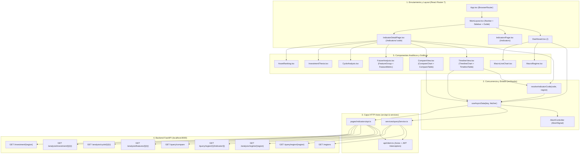

# Arquitectura General del Frontend: `frontend`

El directorio `frontend` constituye la interfaz interactiva y analítica de **Sight**. Desarrollada sobre **React 19**, **TypeScript 6**, **Vite 8**, **Tailwind CSS 4** y **Recharts 3**, su misión es transformar los modelos econométricos, espectrales y de asignación de activos del backend en una experiencia visual de baja latencia, determinista y libre de condiciones de carrera.

---

## 1. Filosofía y Principios de Arquitectura

La arquitectura del frontend de **Sight** se rige por cuatro principios fundamentales:

1. **Gestión Asíncrona Determinista por Clave (`useAsyncData`)**:
   - Toda consulta HTTP se asocia a una clave inmutable (`key`). El estado de carga (`loading`) y la invalidación de datos obsoletos se derivan directamente en tiempo de renderizado comparando `state.key !== key`, eliminando llamadas síncronas a `setState` dentro de `useEffect` y cumpliendo estrictamente las reglas del compilador de **React 19**.
2. **Cancelación Nativa de Condiciones de Carrera (`AbortController`)**:
   - Cada cambio de país, indicador o pestaña aborta de inmediato las peticiones HTTP en vuelo mediante `AbortSignal`, garantizando que una respuesta lenta de una selección previa jamás sobrescriba la vista activa.
3. **Alineación Estricta de Contratos con el Backend (`types.ts`)**:
   - Cero uso de `any`. Todas las respuestas de los endpoints FastAPI (`/query`, `/indicators`, `/regions`, `/analysis`, `/investment`) están respaldadas por interfaces TypeScript que reflejan fielmente los esquemas Pydantic del servidor, incluyendo las diferencias estructurales entre indicadores logarítmicos (`GrowthMethod.LOG`) y de tasas (`GrowthMethod.RATE`).
4. **Separación entre Contenedores de Datos y Vistas Puras**:
   - Las páginas (`Dashboard.tsx`, `IndicatorDetailPage.tsx`) y vistas contenedoras (`TimelineView.tsx`, `CompareView.tsx`) orquestan el estado y la red, mientras que los paneles analíticos (`MacroRegime`, `FutureAnalysis`, `CycleAnalysis`, `InvestmentThesis`, `AssetRanking`) actúan como componentes puros de presentación.

---

## 2. Mapa de Estructura del Frontend

```
frontend/
├── index.html                     # Plantilla raíz HTML5
├── package.json                   # Dependencias (React 19, Recharts 3, Axios, Tailwind 4)
├── tsconfig.app.json              # Configuración estricta del compilador TypeScript
├── vite.config.ts                 # Configuración del bundler Vite 8 + plugin Tailwind
└── src/
    ├── main.tsx                   # Punto de montaje React 19 (StrictMode)
    ├── App.tsx                    # Enrutador principal (BrowserRouter + Routes)
    │
    ├── api/                       # 1. Infraestructura HTTP Base
    │   └── client.ts              # Instancia Axios (baseURL, timeout 120s, interceptores JWT)
    │
    ├── hooks/                     # 2. Hooks de Concurrencia y Estado
    │   └── useAsyncData.ts        # Hook reactivo con clave determinista, useEffectEvent y AbortController
    │
    ├── services/                  # 3. Servicios Globales de Consulta
    │   └── queryService.ts        # Clientes HTTP para Dashboard, regiones y régimen macroeconómico
    │
    ├── layout/                    # 4. Estructura Visual y Marco de Página
    │   ├── MainLayout.tsx         # Marco fijo con Navbar superior, Sidebar lateral y <Outlet />
    │   └── PageHeader.tsx         # Cabecera tipográfica reutilizable para vistas de catálogo
    │
    ├── components/                # 5. Componentes de Interfaz y Motores Visuales
    │   ├── Navbar.tsx             # Barra superior fija con buscador global e indicadores de estado
    │   ├── Sidebar.tsx            # Navegación lateral principal con estado activo (NavLink)
    │   ├── selectors/
    │   │   └── ModeSelector.tsx   # Conmutador de modo de exploración (Timeline vs Compare)
    │   ├── charts/
    │   │   └── MacroLineChart.tsx # Gráfico Recharts para series macroeconómicas del Dashboard
    │   ├── indicators/
    │   │   ├── IndicatorSearch.tsx# Buscador reactivo en tiempo real por código o nombre
    │   │   ├── IndicatorGrid.tsx  # Rejilla responsiva filtrable del catálogo de indicadores
    │   │   └── IndicatorCard.tsx  # Tarjeta de presentación de indicador con metadatos y enlace
    │   └── analysis/
    │       ├── MacroRegime.tsx    # Panel de régimen macroeconómico agregado y desglose de evidencias
    │       ├── FutureAnalysis.tsx # Panel de las 6 familias de features (adaptativo LOG vs RATE)
    │       ├── FeatureGroup.tsx   # Contenedor tabular de cada familia estadística de features
    │       ├── FeatureMetric.tsx  # Formateador numérico, porcentual y de precisión adaptativa
    │       ├── CycleAnalysis.tsx  # Panel de ciclos armónicos robustos, cobertura y dispersión
    │       ├── InvestmentThesis.tsx # Panel de tesis cualitativa, sesgo macro, horizontes y alertas
    │       └── AssetRanking.tsx   # Ranking cuantitativo multi-activo y contribuciones factoriales
    │
    └── pages/                     # 6. Páginas y Vistas de Dominio
        ├── Dashboard.tsx          # Vista ejecutiva por región (Régimen Macro + PIB, Inflación, Desempleo)
        └── indicators/
            ├── IndicatorsPage.tsx # Catálogo explorable de los 11 indicadores macroeconómicos base
            ├── IndicatorDetailPage.tsx # Orquestador integral de análisis por indicador y región
            ├── api.ts             # Clientes HTTP de indicadores/análisis y resolveIndicatorCode()
            ├── types.ts           # Contratos TypeScript alineados con los modelos Pydantic del backend
            └── views/
                ├── TimelineView.tsx # Vista de serie histórica por país con gráfico y tabla desplegable
                ├── CompareView.tsx  # Vista de comparativa transversal entre países filtrable por año
                ├── timeline/
                │   ├── TimelineChart.tsx # Gráfico de línea Recharts de evolución temporal
                │   └── TimelineTable.tsx # Tabla histórica ordenada con fuentes y unidades
                └── compare/
                    ├── CompareChart.tsx  # Gráfico de barras horizontales de ranking entre países
                    └── CompareTable.tsx  # Tabla clasificada de comparación internacional
```

---

## 3. Diagrama Integral de Flujo de Información

El siguiente diagrama muestra cómo fluye la información desde la interacción del usuario en las rutas de React Router hasta los endpoints de FastAPI y de vuelta hacia los componentes analíticos:



---

## 4. Matriz de Conexiones y Contratos entre Frontend y Backend

| Vista / Componente Emisor | Función Cliente HTTP | Endpoint FastAPI Consumido | Servicio Backend Invocado | Contrato TypeScript (`types.ts`) | Propósito Funcional |
|:---|:---|:---|:---|:---|:---|
| [`Dashboard.tsx`](file:///home/dano/sight/frontend/src/pages/Dashboard.tsx) | [`getRegions()`](file:///home/dano/sight/frontend/src/services/queryService.ts#L10-L18) | `GET /regions` | `RegionService.get_regions()` | `Region[]` | Poblar el selector de regiones/países disponibles. |
| [`Dashboard.tsx`](file:///home/dano/sight/frontend/src/pages/Dashboard.tsx) | [`getRegion()`](file:///home/dano/sight/frontend/src/services/queryService.ts#L24-L32) | `GET /query/region/{code}` | `QueryService.get_by_region()` | `RegionData` | Obtener las series de `GDP`, `INFLATION` y `UNEMPLOYMENT` de la región activa. |
| [`Dashboard.tsx`](file:///home/dano/sight/frontend/src/pages/Dashboard.tsx) → [`MacroRegime.tsx`](file:///home/dano/sight/frontend/src/components/analysis/MacroRegime.tsx) | [`getMacroRegime()`](file:///home/dano/sight/frontend/src/services/queryService.ts#L55-L64) | `GET /analysis/regime/{code}` | `AnalysisService.analyze_multiple()` | [`MacroRegimeData`](file:///home/dano/sight/frontend/src/components/analysis/MacroRegime.tsx#L9-L26) | Clasificar el régimen macroeconómico agregado multi-indicador y sus evidencias. |
| [`IndicatorDetailPage.tsx`](file:///home/dano/sight/frontend/src/pages/indicators/IndicatorDetailPage.tsx) | [`fetchIndicator()`](file:///home/dano/sight/frontend/src/pages/indicators/api.ts#L32-L41) | `GET /indicators/{code}` | `IndicatorService.get_indicator()` | [`Indicator`](file:///home/dano/sight/frontend/src/pages/indicators/types.ts#L18-L27) | Cargar metadatos del indicador (categoría, frecuencia, unidad). |
| [`TimelineView.tsx`](file:///home/dano/sight/frontend/src/pages/indicators/views/TimelineView.tsx) | [`fetchTimeline()`](file:///home/dano/sight/frontend/src/pages/indicators/api.ts#L51-L62) | `GET /query/region/{r}/indicator/{i}` | `QueryService.get_by_region_and_indicator()` | [`RegionResponse`](file:///home/dano/sight/frontend/src/pages/indicators/types.ts#L41-L44) | Obtener observaciones históricas (`ObservationResponse[]`) para el gráfico y tabla temporal. |
| [`CompareView.tsx`](file:///home/dano/sight/frontend/src/pages/indicators/views/CompareView.tsx) | [`fetchComparison()`](file:///home/dano/sight/frontend/src/pages/indicators/api.ts#L64-L78) | `GET /query/compare` | `QueryService.compare_regions()` | [`RegionResponse[]`](file:///home/dano/sight/frontend/src/pages/indicators/types.ts#L41-L44) | Comparar un indicador transversalmente entre múltiples países y años. |
| [`IndicatorDetailPage.tsx`](file:///home/dano/sight/frontend/src/pages/indicators/IndicatorDetailPage.tsx) → [`FutureAnalysis.tsx`](file:///home/dano/sight/frontend/src/components/analysis/FutureAnalysis.tsx) | [`fetchFeatureAnalysis()`](file:///home/dano/sight/frontend/src/pages/indicators/api.ts#L101-L112) | `GET /analysis/features/{i}/{r}` | `FeatureEngine.compute()` | [`FeatureAnalysisResult`](file:///home/dano/sight/frontend/src/pages/indicators/types.ts#L126-L130) | Visualizar las 23 métricas estadísticas agrupadas en 6 paneles temáticos. |
| [`IndicatorDetailPage.tsx`](file:///home/dano/sight/frontend/src/pages/indicators/IndicatorDetailPage.tsx) → [`CycleAnalysis.tsx`](file:///home/dano/sight/frontend/src/components/analysis/CycleAnalysis.tsx) | [`fetchCycleAnalysis()`](file:///home/dano/sight/frontend/src/pages/indicators/api.ts#L80-L91) | `GET /analysis/cycle/{i}/{r}` | `CycleAnalysisService.analyze()` | [`CycleAnalysisResult`](file:///home/dano/sight/frontend/src/pages/indicators/types.ts#L70-L77) | Mostrar ciclos armónicos detectados por consenso (HP, Hamilton, Baxter-King + FFT/ACF). |
| [`IndicatorDetailPage.tsx`](file:///home/dano/sight/frontend/src/pages/indicators/IndicatorDetailPage.tsx) → [`InvestmentThesis.tsx`](file:///home/dano/sight/frontend/src/components/analysis/InvestmentThesis.tsx) | [`getInvestmentAnalysis()`](file:///home/dano/sight/frontend/src/pages/indicators/api.ts#L114-L125) | `GET /analysis/investment/{i}/{r}` | `InvestmentAnalysisService.analyze()` | [`InvestmentAnalysisResult`](file:///home/dano/sight/frontend/src/pages/indicators/types.ts#L165-L176) | Presentar tesis cualitativa, sesgo macro, horizontes temporales y alertas activas. |
| [`IndicatorDetailPage.tsx`](file:///home/dano/sight/frontend/src/pages/indicators/IndicatorDetailPage.tsx) → [`AssetRanking.tsx`](file:///home/dano/sight/frontend/src/components/analysis/AssetRanking.tsx) | [`fetchInvestmentAssetRanking()`](file:///home/dano/sight/frontend/src/pages/indicators/api.ts#L127-L137) | `GET /investment/{region}` | `AnalysisService.analyze_multiple()` | [`InvestmentAssetRankingResult`](file:///home/dano/sight/frontend/src/pages/indicators/types.ts#L178-L185) | Clasificar los activos del universo de inversión según su puntuación factorial. |

---

## 5. Descripción Detallada por Submódulo

### 5.1 Gestión de Concurrencia (`src/hooks/useAsyncData.ts`)
El hook [`useAsyncData`](file:///home/dano/sight/frontend/src/hooks/useAsyncData.ts) resuelve de forma unificada los problemas clásicos de carga de datos en React 19:
- **Firma**: `useAsyncData<T>(key: string | null, fetcher: (signal: AbortSignal) => Promise<T>): UseAsyncDataResult<T>`
- **Derivación en Render**: Mantiene un único estado `{ key, data, error }`. Si la `key` actual difiere de `state.key`, la propiedad devuelta `data` es inmediatamente `null` y `loading` es `true` en el mismo ciclo de renderizado, sin necesidad de ejecutar `setState(null)` dentro de `useEffect`.
- **Integración con `useEffectEvent`**: Encapsula el `fetcher` en `useEffectEvent` de React 19 para que el efecto sólo se re-ejecute cuando cambia `key`, evitando bucles infinitos por lambdas recreadas en cada render.
- **Limpieza con `AbortController`**: En la función de retorno del `useEffect`, invoca `controller.abort()`. Si la promesa falla con `controller.signal.aborted === true`, el error se ignora silenciosamente.

### 5.2 Resolución Polimórfica de Indicadores Comerciales (`resolveIndicatorCode`)
En la base de datos de Eurostat y BEA, los indicadores de comercio exterior tienen códigos diferenciados según se consulte un bloque agregado (`EU27_2020`, `US`) o un Estado miembro individual de la UE (`DE`, `FR`, `ES`, etc.):
- [`resolveIndicatorCode(baseCode, regionCode)`](file:///home/dano/sight/frontend/src/pages/indicators/api.ts#L21-L30) traduce transparentemente:
  - `EXPORTS` → `EXPORTS_BY_COUNTRY` (para países individuales de la UE)
  - `IMPORTS` → `IMPORTS_BY_COUNTRY` (para países individuales de la UE)
  - `TRADE` → `TRADE_BALANCE_BY_COUNTRY` (para países individuales de la UE)
- Tanto [`TimelineView.tsx`](file:///home/dano/sight/frontend/src/pages/indicators/views/TimelineView.tsx) como [`IndicatorDetailPage.tsx`](file:///home/dano/sight/frontend/src/pages/indicators/IndicatorDetailPage.tsx) comparten esta resolución para que la serie histórica, las *features*, los ciclos y la tesis de inversión consulten siempre el código efectivo correcto.

### 5.3 Adaptación Dinámica `LOG` vs `RATE` (`FutureAnalysis.tsx` y `FeatureMetric.tsx`)
El motor estadístico del backend (`FeatureEngine`) aplica dos metodologías distintas según la naturaleza del indicador:
- **Series `GrowthMethod.LOG`** (`GDP`, `CPI`, `HOUSE_PRICE_INDEX`, `INDUSTRIAL_PRODUCTION`, `RETAIL_SALES`, `EXPORTS`, `IMPORTS`): Generan `percentage_change`, `log_difference`, `yoy_growth`, `yoy_log_growth`, `cumulative_growth` y `momentum`.
- **Series `GrowthMethod.RATE`** (`INFLATION`, `UNEMPLOYMENT`, `INTEREST_RATE`, `TRADE`): Generan `change` (diferencia simple), `yoy_change` (diferencia interanual) y `momentum`, evitando divisiones por cero o signos invertidos cuando los tipos de interés o saldos comerciales son negativos.
- [`FutureAnalysis.tsx`](file:///home/dano/sight/frontend/src/components/analysis/FutureAnalysis.tsx#L18-L48) inspecciona dinámicamente el payload recibido (`isRateSeries`) y adapta las métricas mostradas en el grupo **Crecimiento**, mientras que [`FeatureMetric.tsx`](file:///home/dano/sight/frontend/src/components/analysis/FeatureMetric.tsx#L27-L74) formatea porcentajes, z-scores y valores decimales pequeños (con hasta 4 decimales para pendientes OLS y diferencias logarítmicas menores a 1 en valor absoluto).

---

## 6. Comandos de Desarrollo y Verificación

```bash
# 1. Instalar dependencias
npm install

# 2. Levantar servidor de desarrollo con HMR (http://localhost:5173)
npm run dev

# 3. Auditoría estática con ESLint 10 y reglas de React 19 Hooks
npm run lint

# 4. Verificación estricta de tipos (tsc -b) y empaquetado de producción
npm run build
```
